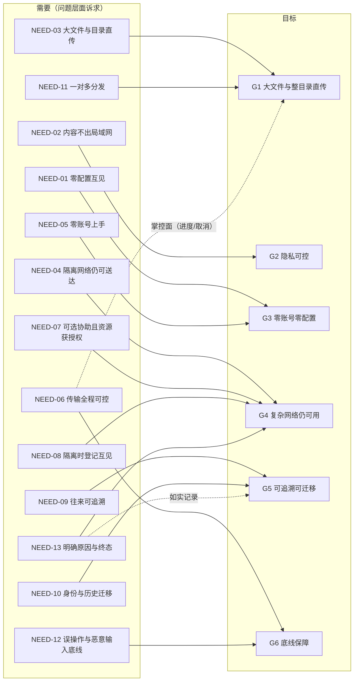
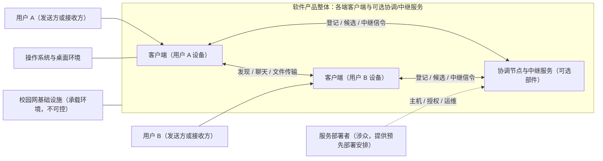
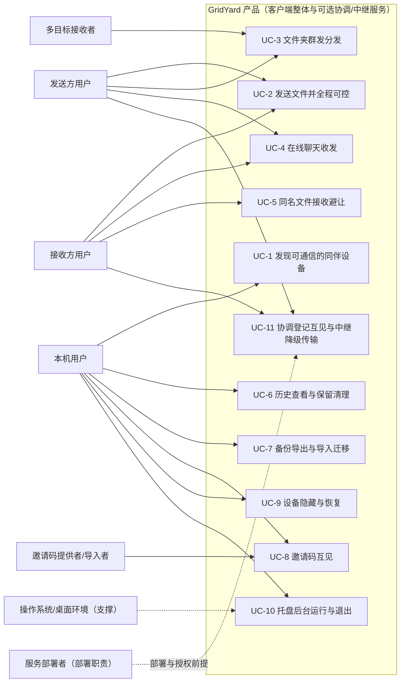

# GridYard（鸽邮）需求规格说明书

| 项目 | 内容 |
| :--- | :--- |
| 项目名称 | GridYard（鸽邮）——校园局域网文件传输与即时交流工具 |
| 文档性质 | 需求阶段文档：面向待建系统，给出问题分析、涉众与价值、目标与范围、用况规约、功能与质量需求及确认安排 |
| 文档目的 | 分析校园资料交接与交流中的问题，明确待建系统应承担的责任、应有的行为与质量，作为需求评阅、设计输入与验收准备的共同依据 |
| 主要读者 | 课程评审教师、目标使用者、项目团队（三名成员）及后续维护者 |
| 方法依据 | 《Requirements Engineering》中文翻译合订本（第 1、2、7—8、12 章）；《Fundamentals of use-case modeling》课程讲义（sr 02）；《Mastering the Requirements Process》相关课程译稿 |

## 阅读说明

本文先说明待建系统要解决的问题及其对涉众的价值，再规定系统应提供的行为、质量与适用条件，最后给出追溯关系和确认、验证安排。

为保证论据与结论可分辨，部分陈述带有来源标记：

| 标记 | 含义 |
| :--- | :--- |
| （经验） | 团队成员或项目提出者的直接使用经验，不是系统性调查结论 |
| （事实） | 公开产品机制或领域常识 |
| （推导） | 由其他陈述推出的分析结论，其前提一并给出 |
| （假设） | 满足目标所依赖、但不能由软件单独保证的环境条件 |
| （拟定） | 建议采用的数值、安排或约束，需经评阅协商后确认 |
| （待确认） | 尚未解决的需求问题，集中列于第 12 章 |

### 编号体系一览

本文所有编号均在下表所列章节首次定义；正文中的交叉引用（含用况对需求编号的引用）用于追溯，引用处不再重复定义。本文自包含，不需要查阅其他文档即可理解全部编号。

| 编号 | 含义 | 定义位置 |
| :--- | :--- | :--- |
| PROB-1、PROB-2 | 归并后的两个核心问题 | 2.3 |
| P1–P4 | 客户画像（虚构人物，用于场景沟通） | 3.3 |
| S1–S4 | 典型使用场景（与 P1–P4 一一对应的叙事化实例） | 6.1 |
| NEED-01～13 | 需要（问题层面的诉求） | 4.1 |
| G1–G6 | 目标（目的—益处—衡量指标） | 4.2 |
| BE-01～14 | 业务动因与响应触发 | 6.2 |
| BUC-1～11 | 业务用况 | 6.3 |
| UC-1～11 | 产品用况 | 7.3～7.13 |
| FR-B1～FR-B8 | 功能需求（按八个功能域组织，共 104 条） | 8.2～8.9 |
| NFR-* | 质量需求（共 22 条） | 9.1 |
| DC-01～10 | 拟定设计约束与接口规约 | 9.2 |
| D-1～6 | 领域事实 | 5.3 |
| E-1～3 | 环境期望 | 5.4 |
| A-1～7 | 环境假设 | 5.4 |
| F-01～30 | 特性索引 | 附录 C |
| Q-01～10 | 待决事项 | 第 12 章 |

### 用况术语约定

- **用况**（use case）描述系统与参与者协作取得有价值结果的过程；**参与者**（actor）是系统边界外与系统交互的角色。每个用况至少向一个参与者提供可观察的价值。
- **基本流**是正常、预期的路径；**备选流**描述其他成功、拒绝、取消或失败路径，写明条件、响应及去向（返回基本流、结束或等待）。错误处理、拒绝、取消与安全防护属于备选流，但不因其归入备选流而可以裁减。
- **前置条件**规定适用状态，**触发条件**说明何事启动用况，**后置条件**规定结束时应满足的状态；成功保证适用于成功结束，其他结果的最低保证适用于一切结束方式。

---

# 第一部分　问题、涉众与目标（WHY / WHO）

---

## 1 引言

### 1.1 编写目的

鸽邮拟利用校园已有网络，为大文件、文件夹和少量即时文本交流提供低门槛的局域网协作工具。本文分析现有交接方式的成本与限制，识别发送者、接收者和服务部署者的利益，确定系统应承担的责任及其环境前提。

需求按"问题—需要—目标—场景—用况—功能与质量要求"的层次展开：第 2～4 章回答为什么做、为谁做；第 5～6 章确定范围、环境条件与业务场景；第 7～9 章规定系统应有行为；第 10 章论证需求如何支撑目标；第 11 章安排确认与验证；第 12 章集中列出尚需协商决定的事项。

### 1.2 预期读者与表述形式

需求文档是项目各参与方相互沟通的主要参照。据此，本文对涉及特定相关方的部分，以其能够理解的形式说明：

| 读者 | 关心的问题 | 对应章节 | 表述形式 |
| :--- | :--- | :--- | :--- |
| 课程评审教师 | 产品为谁解决什么问题；方法链条是否完整、结论是否有据 | 第 1～7、10～12 章 | 问题与价值以非技术语言与画像场景陈述；方法依据可回溯（附录 A） |
| 团队三名成员 | 做到什么程度、如何验证、边界在哪 | 第 5、7～11 章 | 条目化规约、量化判据、接口与约束细节 |
| 后续维护者（含下一届接手者） | 产品范围、扩展方向、变更时的影响范围 | 5.2、9.3 节、第 10 章与附录 C | 边界清单、特性索引与需求联系 |
| 潜在使用者（校园局域网用户） | 这个工具对我有什么用、我的文件与隐私是否安全 | 第 2～4、7 章 | 画像场景与用况故事，不要求理解协议细节 |

### 1.3 术语与陈述类型

本文区分五类陈述并分别落位（方法依据：合订本 1.1.4）：

| 陈述类型 | 语气 | 本文落位 |
| :--- | :--- | :--- |
| 目标 | 规定性（期望成果，由系统与环境共同达成） | 4.2（G1–G6） |
| 需求 | 规定性（由软件保证、以环境现象表述） | 第 7～9 章（UC/FR/NFR） |
| 领域属性（领域事实） | 描述性（无论系统如何运行都成立） | 5.3（D-1～6） |
| 环境期望与假设 | 规定性/描述性（由环境中主体满足） | 5.4（E-1～3、A-1～7） |
| 定义 | 无真值（约定含义） | 阅读说明、附录 B |

满足性论证的形式为：若关键需求被满足、所依赖的假设在环境中成立、相关领域事实成立，则目标达成；论证同时给出反例与剩余风险（见 10.3 节）。

---

## 2 业务背景与现状问题

### 2.1 业务动因

本项目的动因来自项目提出者的直接说明：希望以低成本的日常方式，利用校园已有的网络完成大文件交接——例如操作系统镜像、数百兆到数吉字节的大课件——而不是依赖 U 盘借还，也不经外部账号服务中转；使用重点首先是同一 AP 所服务、允许设备互通的局部网络；同一楼宇或教学区不必然处于同一广播域，并兼顾随手可用的文本交流。

两点边界说明：

- 提出者环境中观察到的约 5Mbps 上行带宽是其所处环境的经验值（经验），用于估计"哪些文件适合在线传送"的量级，**不能当作全校统一的网络承诺**；
- 校园网中 AP 隔离是否普遍、跨网段可达性如何，属于**待确认的环境条件**（见 5.4、第 12 章），本文不将其预设为已查明的事实。

### 2.2 现状传递方式及其问题

现状系统（system-as-is）下，校园局域网内的文件与消息传递依赖四类方式。本文对问题的证据以团队经验与公开机制为主，尚未开展面向真实使用者的系统调查；第 11.1 节的确认安排即针对这一缺口。

| 方式 | 问题 | 依据 |
| :--- | :--- | :--- |
| U 盘 / 移动硬盘 | 需要物理接触与借还；忘带、跨楼层跑腿 | （经验）成员日常经历 |
| | 插入不可信设备有安全风险 | 风险机制存在（事实）；实际发生频率未统计（待确认） |
| 微信 / QQ 传文件 | 需双方登录账号 | （事实）公开产品机制 |
| | 隐私与数据路径不可控 | 具体传输模式随产品版本和连接方式而异，不能一概认定全部经服务器落盘（待确认）；本项目希望减少对外部服务、账号及公网带宽的依赖（经验） |
| | 大文件与批量文件夹体验差 | （经验）团队使用经验；具体限速策略随时点、版本、账号状态变化（待确认），本文不引用具体限速数字 |
| 网盘链接 | 上传下载双向绕行公网，速度受出口带宽与限速策略约束 | 绕行机制为（事实）；速度约束为（经验）与机制（推导） |
| | 绑定账号 | （事实）公开产品机制 |
| SMB 共享 / scp | 通常需要目标地址、身份或权限配置；跨网段能否使用取决于路由、防火墙和共享策略，不能一概写为不可用 | （事实）使用条件与网络策略 |
| | 普通用户门槛高 | （推导）以"未经培训的校园用户"为默认使用者这一设定推出（见 3.3 画像设定），非用户调查结论 |

**与替代工具的对照**：LocalSend、Syncthing、AirDrop 等可作为方案比较对象。应分别核对其发现方式、网络前提、配置成本与平台支持，并用相同任务比较。某个工具在特定隔离网段是否可用须实测，不能仅据名称或一般印象判定。

### 2.3 问题归并

四类方式的痛点可归并为两个**问题**（是问题，不是功能）：

- **PROB-1　发现与建立联系的成本。** 用户需要找到正确的接收设备，并确认可通信；不同现状工具分别通过地址、账号、链接或物理交接实现这一步，各自带来配置或协调负担。减少这一步的成本是本文的分析假说，不意味着所有工具都缺少发现机制。
- **PROB-2　可达性不可预期。** 广播发现、端点直连和辅助节点访问分别依赖不同的网络条件。校园网是否存在 AP 隔离、限制广播还是同时限制直连，须按具体网段确认，不能假定任何校园环境都适用同一路径。

此外，大文件与整目录的交接本身在现有方式下成本高（2.2 节），这是任务层面的痛点，构成 4.1 节 NEED-03 与目标 G1 的直接动因。

### 2.4 问题世界与机器的边界

按"问题世界 vs 机器解决方案"划分事象归属（合订本 1.1.1）：

| 归属 | 事项 | 含义 |
| :--- | :--- | :--- |
| 机器可控（共享现象中由软件控制） | 本机文件的读取与落盘、连接的建立与关闭、心跳与超时节律、确认弹窗与取消、同名避让与校验 | 软件对这些现象的行为可以规定为需求 |
| 环境现象（只能观察、不能控制） | 对端是否在线、校园网是否隔离、磁盘剩余空间、对端用户是否点"接受" | 涉及它们的目标必须写明降级路径与明确终态，并按 5.4 节登记为期望或假设 |

**推论**：依赖环境条件的目标应说明适用前提和条件失效时的结果。第 9 章的可达性处理（NFR-R1）据此要求每次尝试有明确终态，但失败收敛不等于必然送达。

---

## 3 涉众与价值（WHO）

### 3.1 涉众识别

涉众及环境按与产品的关系分层识别。产品和技术环境本身不是人的利益相关方，列在表中用于说明相关人员的作用范围。

| 环 | 包含的涉众 | 关注点 |
| :--- | :--- | :--- |
| 预期解决方案 | GridYard 各端客户端 + 可选协调节点/中继服务 | —— |
| 实际工作区域 | 直接用户（同网段学生、跨楼宇教师、重装/换机用户、群发分发者，见画像 P1–P4）；对端设备的用户、协调节点部署者、被传输文件的原作者；三名开发人员 | 快、稳、隐私、零门槛；接受/拒绝权、带宽成本、内容版权与隐私；可实现性与交付验收 |
| 组织的其他部分 | 课程（发起人与验收方）、网络管理者（AP 隔离策略的管理方） | 验收标准与考核要求；网络策略 |
| 外部世界 | 操作系统/桌面生态、第三方依赖的上游；领域专家、功能受益者、对抗性涉众（嗅探者、恶意请求构造者、注册表投毒者）、开源社区 | 平台与依赖；领域知识；潜在威胁 |

**推论**：若采用独立协调节点，方案将引入部署者这一角色。该角色获得的价值体现为对使用群体的支持，同时承担主机、维护和带宽成本；因此方案比较必须考虑由此增加的利益相关方和责任。

团队分工安排（拟定）：由高扬协调需求分析与文档编写，三名成员共同讨论范围和优先级；涉及使用者、接收者及服务部署者的取舍，应向相应人员确认。

### 3.2 价值与成本

**功能价值**：减少大型资料交接对可移动介质、外部账号和公网带宽的依赖；支持目录与多目标分发；提供进度、结果、往来查询及迁移能力。速度收益须在目标网络和文件规模下评价，不能仅由实验室吞吐推出。

**心理价值**：安心——按约定局域网部署时，协调/中继不持久化文件内容，端点保存与明文风险见下方隐私边界声明；掌控——接收前确认、传输中可取消、同名绝不覆盖；自信——零账号零配置、启动即用；被尊重——离线或隔离时给出明确原因与终态，不悬挂、不假装成功。

价值分析同时考虑受益与代价：

| 涉众 | 获得的价值 | 承担的成本 / 付出的资源 |
| :--- | :--- | :--- |
| 使用者（发送方） | 大文件直传、群发、进度与取消控制 | 发送期间保持应用在线；发送队列占用本机磁盘读带宽（事实） |
| 使用者（**接收方**） | 知情决定权——接收前看到名称/大小/目录预览，**接受或拒绝是接收者的权利**（NEED-06、FR-B5-04/06）；同名绝不覆盖 | 接收目录磁盘空间；被打断的注意力（确认弹窗） |
| 使用者（双方） | 聊天与传输往来可追溯、可迁移 | 本地历史占用磁盘（保留期可调、到期自动清理兜底，FR-B6-07） |
| 协调节点部署者 | 使跨网段使用群体（画像 P2 情境）在隔离环境可互见——支撑角色价值经由被服务群体体现 | 主机、维护时间和中继转发带宽；资源配置应根据负载与运行环境确定。使用者可按策略决定是否请求中继；**部署者的授权、配额和拒绝权仍需另行确认，客户端询问不能替代其同意** |
| 间接涉众：群发接收场景中的其他同学 | 收到作业包；若本人操作客户端确认接收，则同时是直接使用者 | 接收设备、存储与注意力成本；仅由他人代收时才是间接受益者 |
| 间接涉众：被传输文件的原作者 | 资料按授权传播、隐私与署名得到尊重 | 隐私与版权暴露面见下方隐私边界声明 |
| 间接涉众：同网段其他用户 | 大文件不再绕行公网，可能减少对公网出口的占用（推导） | 局域网无线容量和共享带宽也可能被大文件传输占用 |
| 网络管理者 | 期望网络策略得到遵守、服务部署可管理 | 可能增加流量、服务审批与运维成本，不能未经确认宣称零负担 |

**隐私边界要求**：文件内容不经任何服务器落盘（NFR-S4）；本期范围**不包含端到端加密**（端到端加密为登记演进项 F-27），经流式中继转发时，字节流在中继节点上技术可见；协调口令定位为防蹭网的简单口令、不防御主动嗅探（NFR-S1 边界说明）。因此"隐私可控"的准确口径是：**部署在约定局域网内时，文件内容不由协调/中继服务持久化；接收方按授权保存文件，本地聊天记录为明文**，而非"任何中间方都不可读取"。G2 的满足性论证（10.3 节）按此口径执行。本声明只约束所交付软件的行为，不能保证第三方主机运营者不截获数据。

### 3.3 客户画像

画像 P1–P4 是用于分析与沟通的虚构人物，承载代表性场景和期待，不代表已访谈对象。其技能与态度应与目标群体一致，并在后续需求确认中检验；画像用于提出场景、检查需求是否合理及暴露冲突，**不能反过来充当真实需求存在的证据**。

| 画像 | 情境 | 目标 | 关键期待 | 对应目标 |
| :--- | :--- | :--- | :--- | :--- |
| P1 林晓 · 计算机学院大三 · 宿舍六人间 | 晚自习后在宿舍把笔记本上的 3GB 实验数据集交给同一 AP 下同学的台式机；U 盘正在被借用 | 找到正确设备，交接完整资料并知道是否成功 | 自动互见；整文件夹传输与进度取消；顺手发消息核对参数 | G1、G3 |
| P2 王老师 · 跨教学楼授课教师 | 办公室与机房跨 AP 隔离，广播不可达；实验数据涉学生隐私，不愿经网盘中转 | 隔离网络里也能点对点送达 | 协调节点登记互见；直连失败后询问式中继；接收前确认 | G4、G2 |
| P3 陈晨 · 大二学生 · 刚重装系统 | 重装后设备标识变化，好友关系与聊天/传输记录不想丢 | 备份导出导入整体迁移，不必重来 | 备份导出导入；设备关联向导合并旧条目与历史 | G5 |
| P4 小赵 · 班长 · 收发作业包 | 把作业模板发给全组 12 台设备，逐台太繁琐 | 一次分发、各目标独立进度与终态、离线目标自动剔除 | 群发勾选与过滤；独立进度与终态 | G1、G5 |

画像技能与态度均为候选设定：P1/P4 暂设熟悉常见即时通讯但不了解端口配置，P2 关心隐私和跨地点可用性，P3 关心数据迁移。优先级最终需结合真实使用者、频率、损失与实现成本确认。

---

## 4 需要与目标（WHY 的落点）

### 4.1 需要（NEED-01～13）

需要（Need）是问题层面的诉求，先说明使用者希望取得什么结果，再讨论广播、邀请码、协调节点与中继等候选方案（方案比较见 4.4 节）。以下需要通过现状问题（PROB-1/2、2.2 节）和使用场景提出。

| 编号 | 需要（问题层面诉求） | 背景与理由 |
| :--- | :--- | :--- |
| NEED-01 | 局域网内设备零配置自动互见 | 降低寻找接收设备与建立联系的操作负担（PROB-1）；画像 P1 的期待为候选验证情境 |
| NEED-02 | 文件与消息全程留在局域网，不经公网服务器中转或落盘 | 使用者希望减少外部服务与公网带宽依赖；P2 的隐私诉求是虚构画像中的候选情境，需与真实使用者确认 |
| NEED-03 | 大文件与整目录可靠直传 | 现状大文件与批量文件夹体验差（2.2 节）；P1 需带离 3GB 实验数据集 |
| NEED-04 | 复杂校园网（AP 隔离）下仍可送达 | PROB-2；在网络允许且有可达辅助主机时提供协助，否则给出明确失败结果 |
| NEED-05 | 零账号、零配置上手 | SMB/scp 配置门槛、网盘绑定账号；普通用户不经培训直接使用 |
| NEED-06 | 传输全程可控：发送可取消、接收前有确认 | P1 期待进度与取消、P2 期待接收前确认；"掌控"心理价值的来源 |
| NEED-07 | 直连失败时有可选择的协助路径，资源使用得到部署者授权 | 协助是 NEED-04 的落点；使用者决定是否请求中继，部署者决定资源授权和限制，默认询问不能代替部署授权 |
| NEED-08 | 广播不可达时仍有登记互见通道 | 无此通道则跨网段使用情形（P2 情境）无法被服务 |
| NEED-09 | 聊天与传输往来可追溯，历史跨重启恢复 | P3 重装后记录不想丢；往来记录是学习协作场景的凭证 |
| NEED-10 | 换机/重装时设备身份、好友关系与历史整体迁移 | P3 关键期待；损失随使用时长累积，低频高价值 |
| NEED-11 | 一对多批量分发 | P4 向全组 12 台设备发作业包、逐台太繁琐 |
| NEED-12 | 误操作与恶意输入有底线：同名不覆盖、路径防穿越、校验失败拒收 | U 盘方式存在不可信设备风险；覆盖与恶意路径写入的损失不可逆 |
| NEED-13 | 对端离线或隔离时给出明确原因与终态，不悬挂 | 兜底由产品承担（2.4 节推论）；P2 求确定、不接受"假装成功" |

### 4.2 目标（G1–G6）与成功标准

| # | 益处 | 衡量指标 | 验证途径 |
| :--- | :--- | :--- | :--- |
| G1 | 大文件与整目录直传，不再依赖 U 盘与网盘 | 500MB 单文件**回环**（含摘要计算与校验落盘）吞吐 ≥ 190MB/s（拟定实验目标，待协商）；支持多级目录及大于可用内存的文件，实际范围受文件系统、磁盘与协议容量限制 | 按 NFR-P1 设计可重复的实验测试；另评估真实双机交接耗时 |
| G2 | 隐私可控，内容不出局域网 | 约定局域网部署；协调/中继服务不持久化文件内容；端点保存规则明确 | NFR-S4、部署路径核查与内容/日志存储检查；实现语言与隐私无因果关系 |
| G3 | 零账号零配置上手 | 无账号体系；启动后 1 秒内完成首轮互见（广播可达环境） | 按 NFR-P5 测量发现时延 |
| G4 | 复杂校园网（AP 隔离）仍可用 | 隔离场景经"协调登记互见 → 直连 → 中继"完成传输；四级降级任何一级不悬挂 | 用况 UC-8、UC-11；NFR-R1 |
| G5 | 往来可追溯、可迁移 | 聊天/传输历史完整落库并跨重启恢复；换机经备份包整体迁移 | NFR-R3；用况 UC-6、UC-7 |
| G6 | 误操作与恶意输入有底线 | 接收不覆盖已有文件（同名避让）；路径防穿越；校验失败即拒收 | FR-B5-09、FR-B5-03、FR-B5-10 |

**指标适用条件**：NFR-P1 的 190MB/s 是拟定的同机回环工程测试目标（拟定），须结合硬件资源和原型可行性讨论，**不作为校园无线双机的吞吐承诺**。测试应包含摘要计算、校验与保存，并说明存储介质和计时边界。真实校园交接效率、发现时延和失败后的重做成本，应另设用户成效指标（见 4.5 节）。

**可行性分析计划**：分别验证自动发现、直连、辅助节点互见和中继转发在预期网络条件下是否可行，同时估计部署、资源和维护成本。技术原型可用于检验方案，不替代需要与价值的论证。

### 4.3 需要 → 目标的归并关系

G1–G6 是对 NEED-01～13 的归并与承诺：G1←NEED-03/11；G2←NEED-02；G3←NEED-01/05；G4←NEED-04/07/08/13；G5←NEED-09/10；G6←NEED-12/06。NEED-06 与 NEED-13 同时具有掌控与底线两面：接收前确认的掌控面同时体现在 G1 的发送可控与 G6 的接收确认中；NEED-13 的"如实记录"面同时支撑 G4（不悬挂）与 G5（如实落库）。每个 Need 至少落入一个 Goal，无空悬 Need。

### 4.4 方案层的备选评价

应比较不同发现与传递方案的适用条件，避免把某种技术提前当作唯一答案。以下均为**拟定的产品选择**：选择时写明条件、替代与代价，不因某种方案已在同类工具中常见就称其为必然需求。

| 候选方案 | 可支持的需要 | 前提与代价 | 取舍方向 |
| :--- | :--- | :--- | :--- |
| 本地广播发现并直连 | 减少手动配置，降低中转成本（NEED-01/03） | 两端位于允许广播与直连的网络；广播规模须受控 | 作为单 AP 场景优先考虑的路径 |
| 邀请码或手动端点后直连 | 自动发现不足时定位已知同伴（NEED-04/08） | 需要产品外交换文本或地址，且仍需可直连 | 作为补充路径，不承诺解决全部隔离 |
| 协调登记后尝试候选直连 | 广播不可达时获得联系信息（NEED-08） | 需要获准部署且双方可达的辅助主机 | 有部署条件时纳入扩展范围 |
| 流式中继 | 两端不能直连但均可访问中继时协助送达（NEED-07） | 带宽与运维成本集中；中继可接触字节流 | 由部署授权和用户策略共同限制，不作为无条件兜底 |
| 仅手动地址或外部账号服务 | 复用现有联系方式 | 前者增加配置负担；后者依赖外部服务和账号 | 与低门槛、低外部依赖目标比较后决定，不因技术偏好直接排除 |

### 4.5 用户成效与工程判据的区别

技术判据（如回环吞吐）用于检查软件质量，用户成效用于评价问题是否得到解决。以下标准的适用条件、取样方式与阈值需同使用者协商，不伪造数据、不预先宣称已达成：

| 目标 | 应向使用者确认的成效 | 收集证据的方式 |
| :--- | :--- | :--- |
| G1 | 在真实文件规模和校园环境下，交接是否比现有办法省时省事；目录过滤规则是否可接受 | 用相同资料完成两种办法，记录端到端耗时、操作数、失败与重做成本 |
| G2 | 可接受的中转、内容可见方、端点保留与备份保管边界 | 以数据流和实际明文示例说明，请各受影响方确认 |
| G3 | 首次使用是否无需帮助找到正确同伴 | 观察新使用者从启动到选中目标，记录求助和误选；阈值待协商 |
| G4 | 必须服务哪些网络环境，谁能提供获准且可达的辅助主机 | 明确网络条件、部署责任与服务成本，分别验证成功送达和可解释失败 |
| G5 | 哪些往来必须保留、保存多久、迁移哪些层才算完整 | 用重装或换机场景走查，确认误删与备份泄漏的可接受边界 |
| G6 | 绝不覆盖等底线应在什么并发和异常条件下成立 | 用同名、拒绝、磁盘不足及异常摘要情境走查；分别验证底线与已知限制 |

---

## 5 范围、领域事实与环境条件

### 5.1 边界：业务工作、产品整体与部署单元

区分三个层次，分别确定责任边界：

- **业务工作**是校园成员完成资料交接与交流的全过程，包括人员、规则、网络条件、软件及产品外的邀请码交接；**业务工作大于软件产品本身**。
- **产品规约边界**（第 7 章用况的对象）为协作软件整体：各端客户端及可选协调/中继服务均属于产品内部。双方用户是外部参与者；协调/中继服务是产品内部部件，不无说明地画成外部参与者。使用者可位于不同端；同一自然人也可操作两台设备（如换机迁移）。产品用况的基本流中"系统"指该整体，并明确哪一端展示结果。
- **部署与接口视角**下，单客户端与对端程序、协调服务存在外部接口。它们可作为组件视角的交互对象，但不在本文整体产品用况中重复列为外部参与者；接口互操作要求由第 9 章承接。

产品用况的主要参与者为使用者（发送方、接收方、源机、目标机等角色）；操作系统与桌面环境为外部支持参与者。服务部署者承担预先部署、授权和运维责任，在不直接参与单次交互时作为相关涉众记录。对端协议异常属于产品边界的输入验证与接口兼容问题，不能用"对端一定守约"免除应有防护。

### 5.2 范围内与范围外

**范围裁定标准**：范围由目标（G1–G6）决定；不服务任何 Goal、或超出 Goal 衡量口径的能力列入范围外并逐条回指。

**范围内**：局域网设备发现与设备列表、设备管理（备注/置顶/隐藏/好友/删除/关联合并）、在线聊天收发与时间线、文件与文件夹发送（进度/取消/群发/中继降级）、文件接收（确认/同名处理/校验落盘）、本地历史记录与保留清理、备份导出导入、设置/系统托盘/优雅关停/本机多实例，以及独立协调节点与流式中继服务程序。

**范围外（非目标）**：账号登录与用户体系（与 G3 相悖）、公网通信与云中转（违背 G2）、离线消息投递与跨设备漫游（G1–G6 以在线直传为前提）、群聊（超出 G1/G5 一对一口径）、文件内容入库与端到端加密（G5 落库对象为往来记录而非文件内容；加密为演进项 F-26/F-27）、Windows/macOS 打包发布（交付与验收限定当前平台）；协调节点身份认证增强另行评估（F-29）。

**开放问题**：大广播域内的设备发现可能带来消息量、列表规模及共享带宽问题，须先界定广播域和目标规模。因此核心范围限定单 AP 场景；跨隔离网络的协调与中继以明确的可达和部署条件为前提，全校范围治理另作扩展研究（F-30）。

### 5.3 领域事实（D-1～6）

以下陈述无论系统如何运行都成立，是满足性论证的前提：

| # | 领域事实 | 用途 |
| :--- | :--- | :--- |
| D-1 | 本产品采用的本地广播依赖广播域及网络策略，不默认具有跨子网传播能力 | 论证"广播路径只服务同网段"及协调/中继路径的必要性 |
| D-2 | TCP 连接要求两端 IP 层可达，不要求同网段 | 论证"隔离网段内经可达主机中继"在原理上可行 |
| D-3 | 文件写入受权限与剩余空间约束，磁盘满或无权限时写入失败 | 支撑 UC-2/UC-5 的写入失败备选流 |
| D-4 | 在摘要可信且计算与比对正确的前提下，SHA-256 可高置信度检测内容差异；摘要本身不证明发送者身份，也不能抵御可同时改写内容与摘要的攻击者 | 支撑传输完整性检查；摘要一致不等于身份认证 |
| D-5 | 校园网由学校已部署的 AP/交换机承载，其策略行为不由项目控制 | 支撑 AP 隔离作为环境现象的归属（2.4 节） |
| D-6 | 目标名称可被其他进程并发创建；事先检查不存在，不能保证随后写入时仍不存在 | 说明"不覆盖"保证还需要并发安全的创建与写入规则，应通过设计审查和异常测试验证 |

### 5.4 环境期望（E-1～3）与假设（A-1～7）

**规定性期望**（由环境中单个主体负责，软件不能强制）：

| # | 期望 | 责任主体 | 若不成立的后果 |
| :--- | :--- | :--- | :--- |
| E-1 | 对端用户在知情（名称/大小/预览）后作出接受或拒绝的决定 | 对端用户 | 请求悬挂至对端取消或超时，发起侧落失败终态（不悬挂，NFR-R1） |
| E-2 | 兼容部署中的各端程序按既定接口规约应答（发现、请求、回执、取消） | 对端程序（其用户） | 交互失败并落明确终态；恶意偏离由 NFR-S3 防线响应 |
| E-3 | 目标机用户阅读身份处理预警后确认或放弃导入；保留/替换/拒绝身份层由约定规则计算 | 目标机用户 | 未确认则不执行导入；不把规则自动决策写成用户可任选身份策略 |

**描述性假说与假设**：

| # | 假设 | 性质 | 来源 |
| :--- | :--- | :--- | :--- |
| A-1 | 运行主机具备回环网络与至少一块可用网卡；局域网内 UDP 广播未被隔离（被隔离时依赖协调节点路径） | 假说 | 网络与部署条件分析 |
| A-2 | 协调节点路径要求客户端与节点间 TCP 可达（不要求 UDP）；中继额外占用节点带宽，仅在两客户端直连不可达、但各自仍能 TCP 连接中继主机时适用 | 假说 | 网络与部署条件分析 |
| A-3 | 本地历史数据库位于支持其事务语义的本地文件系统；接收目录另须具备足够空间和写入权限，网络挂载接收目录的适用性待确认 | 假说 | 网络与部署条件分析 |
| A-4 | Linux 桌面会话提供文件选择门户与系统托盘协议支持；无托盘环境时关窗确认弹窗给出相应文案 | 假说 | 部署条件分析 |
| A-5 | 隔离场景存在一台校园网内 TCP 可达、可由团队或用户部署协调节点的主机 | 假说 | 由 G4 适用条件提出：**G4 的成立依赖此假设**；若某环境不存在可部署主机，该环境中 G4 不可达，属于需要事先说明的适用限制（10.3 节论证引用） |
| A-6 | 邀请码经产品外的任意渠道传递（当面、约定聊天工具、邮件等），本产品不规定其分发渠道 | 假说 | 由邀请码交接场景提出（推导） |
| A-7 | 网络管理方允许在目标广播域内执行约定频率的发现与数据传递；广播域、隔离策略和共享容量应在部署前确认 | 假说 | 网络管理及部署条件分析；多网卡发送行为另由 FR-B1-03 规定 |

接口说明：E-2 记录跨版本或第三方兼容部署的互操作前提，不替代本产品两端各自的义务；偏离协议的输入仍须按 NFR-S3 处理。协调节点注册表中的设备身份由客户端自报，不得把"自报身份为真"作为默认可信前提（身份认证增强见 F-29）；本文任何论证均不引用"对端身份可信"。

### 5.5 业务规则（产品须执行的策略）

| 规则 | 口径 | 承载条目 |
| :--- | :--- | :--- |
| 保留期 | 档位 0（永久）/7/30/90 天（业务规则），负值按 0；启动时清理一次、此后每小时；按 UTC 严格早于截止时刻删除；清理不触碰本地文件 | FR-B6-07 |
| 同名接收避让 | 目标已存在时自动改名 `name (n)`（业务规则：单文件保留扩展名、目录不加后缀），绝不覆盖；确认弹窗与完成提示仍显示发送端原名 | FR-B5-09 |
| 自动接受 | 默认关闭并持久化；开启后跳过逐次确认直接接受并提示"已自动接受" | FR-B5-07 |
| 中继策略 | 询问后中继（默认）/自动/从不三档；询问档约 2 分钟无操作自动失败（业务规则） | FR-B4-14 |
| 隐藏自动恢复 | 隐藏设备的入站消息或传输请求首次归档即自动恢复显示；重复消息不触发 | FR-B2-04、FR-B3-17 |

---

## 6 场景、业务事件与业务用况

### 6.1 典型使用场景（S1–S4）

场景以叙事方式捕获期望行为的典型实例，是需求获取与涉众沟通的单元（合订本 7.6.1：目标覆盖一类行为，场景给涉众以具体故事）。四个场景与画像 P1–P4 一一对应；服务部署者作为涉众在 3.1 节描述，不另设场景编号。

- **S1 宿舍直传**（对应 P1）：林晓和同宿舍的同学分别在笔记本与台式机上打开鸽邮，两台设备处于允许互通的同一 AP 网络。林晓选择同学设备并发送 3GB 数据集目录，同学确认接收，双方查看进度与结果，并用文本消息核对参数。
- **S2 跨楼宇隔离送达**（对应 P2）：王老师在办公室（AP 隔离网段）与机房之间经协调节点登记互见；发送实验数据时直连候选全部失败，系统询问是否经中继，确认后经中继完整送达，全程不经网盘。
- **S3 重装迁移**（对应 P3）：陈晨重装系统前导出备份包，重装后导入，设备身份、好友标记与聊天/传输历史整体恢复，旧条目经关联向导合并。
- **S4 班级分发**（对应 P4）：小赵把作业模板文件夹群发给全组 12 台在线设备，逐台独立进度与终态，离线的 2 台自动剔除，接收的同学各自确认后拿到完整副本。

### 6.2 业务动因与响应触发（BE-01～14）

业务动因是交接资料、交流信息、保留或迁移往来。下表将其关联到产品响应的触发，保留 BE 编号便于追溯；其中用户意图属于业务输入，跨客户端到达的消息属于组件视角的输入，心跳等属于运行触发。由于两端客户端均在产品边界内，不能把端间输入一概视为整个业务工作的外部事件。优先级为拟定的高/中/低三档，须结合价值与风险确认。

| 编号 | 触发事项 | 触发层次与类型 | 响应 BUC | 优先级 |
| :--- | :--- | :--- | :--- | :--- |
| BE-01 | 邻居设备上线 | 运行条件变化（邻端可被发现） | BUC-1 | 高 |
| BE-02 | 心跳超时（超时判定见 DC-10） | 时间触发（周期检查） | BUC-1 | 高 |
| BE-03 | 用户要发消息 | 外部（用户） | BUC-2 | 高 |
| BE-04 | 对端来消息 | 产品输入（客户端组件视角） | BUC-2 | 高 |
| BE-05 | 用户要发文件/文件夹 | 外部（用户） | BUC-3 | 高 |
| BE-06 | 对端请求传输 | 产品输入（接收端组件视角） | BUC-4 | 高 |
| BE-07 | 一方取消传输 | 外部（双方） | BUC-3 / BUC-4 | 高 |
| BE-08 | 直连全部失败且策略允许中继 | 条件（中继策略裁决） | BUC-5 | 中 |
| BE-09 | 用户发起重装/换机迁移 | 外部（用户） | BUC-6 | 中 |
| BE-10 | 保留期到期 | 时间触发（每小时任务） | BUC-7 | 中 |
| BE-11 | 应用启动 | 外部输入（用户或操作系统） | BUC-8 | 高 |
| BE-12 | 应用退出（托盘/关窗/系统终止信号） | 外部（用户或操作系统） | BUC-9 | 高 |
| BE-13 | 配置变更（协调/保留期/自动接受） | 外部（用户） | BUC-10 | 中 |
| BE-14 | 隐藏设备的消息或传输请求 | 产品输入（接收端组件视角） | BUC-11 | 低 |

每个触发应对应有价值的响应，并检查输入、输出和数据变化是否与相应用况一致；检查发现遗漏时，应回到需要与工作边界重新分析。

### 6.3 业务用况（BUC-1～11）

BUC 以业务成果为导向组织响应，技术触发仅说明该成果由何时、何处启动，不单独决定业务边界；**步骤只写业务步骤，协议帧与内部机制留在第 8～9 章**——BUC 层是用况模型中承载沟通与获取职能的"轮廓视图"（合订本 7.6.3）：

| BUC | 职责 | 服务的 Goal | 预期成果 | 主要功能域 | 优先级 |
| :--- | :--- | :--- | :--- | :--- | :--- |
| BUC-1 | 设备发现与列表维护 | G3、G4 | 广播可达时无需配置即见邻居列表；在线与来源标记不等于身份认证（在线/最近见过/置顶三段）；隔离场景经协调候选补充互见 | FR-B1 | 高 |
| BUC-2 | 聊天收发与时间线 | G5 | 双方消息按序进入统一时间线，重复不重显，往来可回查 | FR-B3 | 高 |
| BUC-3 | 发送会话 | G1 | 发送方全程受控：进度可见、可取消、群发一次完成 | FR-B4 | 高 |
| BUC-4 | 接收确认与落盘 | G1、G6 | 接收方知情确认后拿到与源一致的内容：同名不覆盖、校验失败拒收 | FR-B5 | 高 |
| BUC-5 | 中继降级 | G4 | 直连不可达时内容仍经中继完整送达，降级不悬挂 | FR-B4-14、NFR-R1 | 中 |
| BUC-6 | 备份导出导入 | G5 | 换机/重装后身份、好友与历史整体迁移，不必重来 | FR-B7 | 中 |
| BUC-7 | 历史保留清理 | G5 | 有限保留期下自动清理到期记录；永久档不承诺容量有界 | FR-B6 | 中 |
| BUC-8 | 启动恢复 | G5 | 重启后按规定的最近条目数量恢复已持久化的目录、会话与传输记录 | FR-B1-12、FR-B3-16、FR-B6-03 | 高 |
| BUC-9 | 优雅退出 | G5 | 正常退出前保存已受理的数据，进程收敛；未排空的兜底结果另行说明 | FR-B8-05/06 | 高 |
| BUC-10 | 配置即时生效 | G4、G5 | 配置改动即时生效，无需重启 | FR-B8-02/03 | 中 |
| BUC-11 | 隐藏自动恢复 | G5 | 屏蔽不误事：隐藏设备的来件按规则自动恢复可见 | FR-B2-03/04、FR-B3-17 | 低 |

**BUC↔Goal 双向覆盖**：正向见上表；反向——G1←BUC-3/4；G2←无专属 BUC（横切质量，由 NFR-S4 与数据处理规则在全部 BUC 上横切保证）；G3←BUC-1；G4←BUC-1/5/10；G5←BUC-2/6/7/8/9/10/11；G6←BUC-4。除横切的 G2 外无空悬 Goal。

BUC-3 的业务步骤为：发送者选定资料及接收对象 → 接收者知情接受或拒绝 → 系统传递资料并展示进度 → 双方取得真实结果。分块、序列化和回执属于软件机制，不作为业务步骤本身。其他 BUC 同样按"输入意图—处理责任—对外成果"阅读。

### 6.4 BUC → 产品用况映射与用况分层定位

| BUC | 产品用况（第 7 章） |
| :--- | :--- |
| BUC-1 | UC-1、UC-8（定向互见）、UC-11（协调候选互见） |
| BUC-2 | UC-4 |
| BUC-3 | UC-2、UC-3 |
| BUC-4 | UC-2、UC-5、UC-11 |
| BUC-5 | UC-11 |
| BUC-6 | UC-7 |
| BUC-7 | UC-6 |
| BUC-8 | UC-1（目录恢复）、UC-4（会话恢复）、UC-6（记录恢复） |
| BUC-9 | UC-10 |
| BUC-10 | UC-6（保留天数）、UC-11（协调配置） |
| BUC-11 | UC-9 |

**用况的两层定位**：用况是一种边界相当模糊的操作说明形式，不适合直接开展有意义的分析，但它给出主体必须执行哪些操作的轮廓视图，对需求获取与涉众沟通非常有用，且会把支撑操作的功能与非功能目标留在隐含状态（合订本 7.6.3）。本文据此分两层使用：BUC 层（6.3 节）＝轮廓视图，业务步骤可见、机制留隐含，承载沟通与获取职能；产品用况层（第 7 章）＝规约化用况，从 BUC 派生、细化事件流，展示触发/前/后条件，可推导测试用例，承载规约与验收职能。对用况模型的"有意义分析"（目标推导、完备性、冲突、风险）由第一部分与第 10 章的制品承担；产品用况把隐含目标显式回连——每个用况标注服务的 Need/特性，经 10.2 节追溯链可达 Goal。

---

# 第二部分　规格主体（WHAT）

---

## 7 参与者与产品用况

### 7.1 参与者

本章规约**协作软件整体**：客户端和可选协调/中继服务均在产品边界内；两端用户是外部参与者；客户端、线程和数据库不作为该整体的外部参与者。

| 参与者 | 类型 | 角色说明 | 关联用况 |
| :--- | :--- | :--- | :--- |
| 本机用户 | 主要 | 操作本端应用完成设备发现、设备管理、历史查看、备份迁移、隐藏恢复、托盘与退出 | UC-1、UC-6、UC-7、UC-8、UC-9、UC-10 |
| 发送方用户 | 主要 | 选择并发送文件/文件夹，决定是否中继、中途取消 | UC-2、UC-3、UC-4、UC-11 |
| 接收方用户 | 主要 | 在知情（名称/大小/预览）后接受或拒绝来件 | UC-2、UC-4、UC-5、UC-11 |
| 多目标接收者 | 主要 | 群发场景中的各接收方，彼此独立作出决定 | UC-3 |
| 邀请码提供者 / 导入者 | 主要 | 在产品外交换邀请码后建立定向互见 | UC-8 |
| 服务部署者 | 相关涉众（部署职责） | 提供协调/中继主机的部署、授权与运维；不直接交互时不充当单次用况参与者 | UC-11（前置安排） |
| 操作系统与桌面环境 | 外部支持 | 提供系统托盘、文件选择门户、进程终止信号等环境能力 | UC-10 等 |

上述使用者角色可由同一自然人承担（如换机迁移时源机用户与目标机用户为同一人；发送与接收也是相对角色）。

说明：上图为参与关系示意（Mermaid 绘制），不是工具生成的标准 UML 用况图；实线表示交互关系，部署者虚线只表示前置责任；发起与参与关系见各用况的参与者与触发条件。

### 7.2 用况清单与共同保证

| 用况 | 名称 | 服务的 Goal | 一句话价值 |
| :--- | :--- | :--- | :--- |
| UC-1 | 发现可通信的同伴设备 | G3、G4 | 不交换地址也能找到同伴，列表状态不冒充身份认证 |
| UC-2 | 发送文件并全程可控（含中途取消） | G1、G6 | 发送者可控、接收者知情，结果真实不虚报 |
| UC-3 | 文件夹群发分发 | G1 | 一次指定多目标，各接收者独立决定与终态 |
| UC-4 | 在线聊天收发 | G5 | 局域网内即时文本交流并可追溯 |
| UC-5 | 同名文件接收避让 | G6 | 新资料收得下，旧文件保得住 |
| UC-6 | 历史查看与保留清理 | G5 | 往来可查、保留可控、删记录与删文件分清 |
| UC-7 | 备份导出与导入迁移 | G5 | 换机/重装不必重来 |
| UC-8 | 邀请码互见 | G4 | 自动发现不足时定位已知同伴 |
| UC-9 | 设备隐藏与恢复 | G5 | 列表可整理，屏蔽不误事 |
| UC-10 | 托盘后台运行与退出 | G5 | 后台继续收发，正常退出尽量完成已受理的数据保存 |
| UC-11 | 协调登记互见与中继降级传输 | G4 | 隔离环境的有条件协助路径，不悬挂 |

**共同保证**（适用于全部用况）：结果与已知事实一致；不因失败误报成功；不擅自更改无关数据；成功后置仅在成功结束时适用。通信断开时，各端只能按各自已知事实收尾，**不能保证断连瞬间双方状态或持久化结果同步**。存储不可用时按 NFR-R4 提示历史可能缺失，不能一面允许在线降级、一面保证每条记录必然写入。备选流描述条件、响应和去向；错误处理、拒绝、取消与安全防护不因被归入备选流就成为可随意裁掉的功能，交付优先级由其需求和风险决定。用况中引用的 FR/NFR/DC 编号用于追溯，其定义见第 8、9 章；待决事项见第 12 章，需经评阅确认后作为设计与验收依据。

拟定用况评阅分工：UC-1/2/3/4/5 冯春霖，UC-6/9 杜若贤，UC-7/8/10/11 高扬。负责人组织走查与修订，团队共同评阅；涉及外部涉众利益的取舍须向对应人员确认。

### 7.3 UC-1　发现可通信的同伴设备

| 要素 | 规约 |
| :--- | :--- |
| 目标与价值涉众 | 本机用户找到可交互的同伴，减少交换地址与手动配置的负担；列表状态不冒充身份认证 |
| 参与者 | 两端使用者；本机使用者发起 |
| 触发条件 | 用户启动应用；运行期间收到新同伴的发现信息也可触发列表更新 |
| 前置条件 | 应用可启动；基本成功路径要求两端应用在线且网络允许发现信息通过 |
| 基本流 | 1. 用户启动应用，用况开始；2. 系统恢复已持久化的最近设备目录，并启动发现；3. 系统取得对端有效发现信息，在对应列表显示设备名、地址与在线状态；4. 用户可选中设备进入聊天或传输；当本端显示所发现设备及其当前状态时，本次发现用况结束。无需等待用户刷新，也不以对端列表同步更新作为本端发现成立的前提。 |
| 备选流 | 2a. 发现通道无法建立：按 FR-B1-01 回退备用方式，再失败则记录发现服务不可用；历史目录仍可展示，本次自动发现结束。3a. 无有效发现信息：保持空列表或历史离线条目，不伪造在线；用户可转 UC-8/UC-11，或结束本次尝试（空态具体提示待确认，Q-08）。3b. 已有设备超过保活期限未被观测：更新为离线，列表更新结束。3c. 用户刷新：按 FR-B1-07 重建相应发现来源并重新发现，返回步骤 3；不能保证刷新瞬间在线条目不被移除。4a. 用户搜索、备注或置顶：按 FR-B1-14、FR-B2-01/02 更新呈现；操作完成即结束，无需重复刷新。 |
| 成功后置 | 本端列表含已发现同伴的有效状态；存储可用时按设备目录规则持久化，不因心跳更新丢失管理标记 |
| 其他结果与最低保证 | 发现不到不等于设备不存在；不产生虚假在线；不因本次发现失败删除既有历史；遵守共同保证 |
| 规则与质量 | NFR-P5 规定测试条件与发现时延目标（验收目标）；保活节律见 DC-10、NFR-R2 |
| 追溯 | NEED-01/05/13；G3；BUC-1/8；F-02/05/20/23；FR-B1 |

### 7.4 UC-2　发送文件并全程可控（含中途取消）

| 要素 | 规约 |
| :--- | :--- |
| 目标与价值涉众 | 发送者可知进度与结果并取消；接收者知情接受或拒绝，保有文件和存储空间的控制权 |
| 参与者 | 发送方用户、接收方用户 |
| 触发条件 | 发送方选择文件并提交发送请求 |
| 前置条件 | 已确定目标设备；文件可读取；双方在线且存在可用通信路径为成功路径的前提 |
| 基本流 | 1. 发送者提交文件发送请求，用况开始；2. 发送端显示正在连接及等待接收决定；3. 接收端向接收者展示来源、名称与大小，接收者接受；4. 系统在接收条件满足时传送文件，两端展示进度；5. 接收端完成保存与完整性检查，双方按各自已知结果展示终态，存储可用时记录传输结果；当发送者取得完成结果且接收者可访问所保存文件时成功结束。 |
| 备选流 | 2a. 无可达路径：可按 UC-11 请求协助；不具备条件或全部失败则提示原因并结束。3a. 接收者已开启自动接受：系统按该授权跳过逐次询问并提示，回到步骤 4。3b. 接收者拒绝：系统反馈拒绝并结束，不传送文件。3c. 等待确认期间请求被对端终结（取消/超时/断连）：关闭该请求的确认界面并提示，结束。4a. 任一方在支持取消的状态请求取消：本端停止继续该任务，尽力通知对端；按 FR-B4-09、FR-B5-13 清理当前半成品并结束，对端无法收到通知时由其自身错误或超时收敛。4b. 连接被探测到断开：记录本端已知失败原因并结束。4c. 超过无进展时限（业务规则，30 秒）无网络进展：按超时结束。4d. 读写或校验失败：提示相应原因，清理应清理的当前半成品并结束；同名处理按 UC-5。 |
| 成功后置 | 接收文件可用，正常发送方提供摘要时校验通过；发送与接收两端按实际完成结果展示。历史保存以存储可用为条件 |
| 其他结果与最低保证 | 未取得完成证据的一端不显示成功；不覆盖既有文件；**断连不保证两端终态完全同步**；无历史模式须告警；取消清理不回滚目录任务中此前已完成文件 |
| 规则与质量 | FR-B4-08/09、FR-B5-03/07/10/13；无进展超时 30 秒（业务规则）。摘要检查的非认证性质见 D-4 |
| 追溯 | NEED-03/06/13；G1/G6；BUC-3/4；F-01/11/12/15；FR-B4/B5 |

### 7.5 UC-3　文件夹群发分发

| 要素 | 规约 |
| :--- | :--- |
| 目标与价值涉众 | 分发者一次指定多个接收目标；每位接收者独立决定是否接受，结果彼此独立 |
| 参与者 | 发送方用户、多位接收方用户 |
| 触发条件 | 分发者提交内容和选定的目标集合 |
| 前置条件 | 有可读的文件或目录；发起时至少有一个有效在线目标；多个目标构成典型群发场景 |
| 基本流 | 1. 用户选定目录与多台目标设备并发送，用况开始；2. 系统准备可发送内容清单，展示各目标独立任务；3. 各接收者分别确认；4. 系统对接受的目标独立传递并展示进度；5. 当所有已建立任务取得完成、拒绝、取消或失败终态时，本次群发结束；全部预期目标完成为完整成功，混合结果为部分成功。 |
| 备选流 | 1a. 路径无效或无有效目标：提示且不建立任务，本次尝试结束。1b. 准备中重复发送：拒绝重复请求，原请求继续步骤 2。2a. 某目标在建立任务前离线：剔除并显示有效目标变化；其他目标继续；不为未建立任务凭空生成传输历史。3a. 某目标拒绝或取消：该目标按 UC-2 收尾，其他目标继续步骤 4。4a. 某目标直连失败：按其策略进入 UC-11 或结束该目标任务；其他目标继续。4b. 某目标中途失败：按 UC-2 清理并记录可得结果，其他任务继续。 |
| 成功后置 | 完成目标得到按发送清单规定的目录副本；各任务独立呈现结果，存储可用时保存历史 |
| 其他结果与最低保证 | 单个目标失败不冒充整体成功，也不使其他任务被误判失败；过滤规则可能排除隐藏文件及符号链接，不承诺复制源目录全部内容；群发不提供聚合进度（本期边界，9.3 节） |
| 规则与质量 | FR-B4-03 的清单规则、FR-B4-13 的目标选择与独立会话 |
| 追溯 | NEED-03/11；G1；BUC-3；F-11/13/14；FR-B4 |

### 7.6 UC-4　在线聊天收发

| 要素 | 规约 |
| :--- | :--- |
| 目标与价值涉众 | 会话双方交流文本并在存储可用时追溯往来；状态措辞不误导为对方已收到或已读 |
| 参与者 | 会话双方用户 |
| 触发条件 | 用户发送文本；或产品接收到对端有效消息 |
| 前置条件 | 成功发送需要目标在线及可用链路；查看既有历史不以目标在线为前提 |
| 基本流 | 1. A 提交有效文本，用况开始；2. A 端显示发送中，确认消息发出后显示已发送；3. B 端收到并通过校验后显示消息，按规则提示并保存；4. B 可回复，按相同规则处理；当本次消息处理结果已展示时用况结束，不强制等待 B 回复才算一次发送完成。 |
| 备选流 | 1a. 对端离线：禁用发送并保留历史可读，本次发送不成立；恢复后用户重新发起。2a. 连接仍在建立：按已接受请求顺序等待处理，连接失败则显示失败并结束；不承诺离线自动重试。2b. 发送请求未被接受：保留输入并提示原因，结束；已接受后失败则保留失败气泡。3a. 重复消息：不重复显示、通知和落库，该消息处理结束。3b. 收到非法内容：不加入会话并按协议结束本次连接，结束。4a. 查看更早历史：按 FR-B3-12 分页；查询失败须复位忙碌并允许重试，本次查询结束。 |
| 成功后置 | 各端显示自己实际处理的消息；存储可用时按"本地发送成功"或"有效入站"的口径保存；**已发送不等于对端确认** |
| 其他结果与最低保证 | 发送失败的消息不持久化；存储不可用不阻断在线交流，须提示历史可能缺失；不保证两个端点都有同一份完整记录 |
| 规则与质量 | 输入上限 4000 字符、3600 提示（界面规则）；无撤回和送达回执（9.3 节边界）；NFR-R3/R4 |
| 追溯 | NEED-09；G5；BUC-2/8；F-09/10/20；FR-B3 |

### 7.7 UC-5　同名文件接收避让

| 要素 | 规约 |
| :--- | :--- |
| 目标与价值涉众 | 接收者保住既有文件，仍可接收同名新资料；这是 UC-2 接收步骤的细化情境，不是假定必须独立实现的功能模块 |
| 参与者 | 发送方用户、接收方用户 |
| 触发条件 | 接收者接受一个保存目标名称已存在的传输 |
| 前置条件 | 接收目录中存在同名文件或目录；基本成功路径要求可写且空间足够 |
| 基本流 | 1. 接收者接受传输，用况开始；2. 系统识别名称冲突，按 FR-B5-09 的改名规则寻找可用名称；3. 系统保存新内容并作适用的完整性检查；4. 完成后以可访问的新路径提供文件，通知仍显示发送端原名；当新文件可用且原文件未被覆盖时成功结束。 |
| 备选流 | 2a. 新候选名仍冲突：按命名规则继续避让；并发创建是否受安全保护须在设计与测试中验证（Q-09），不以存在性检查直接证明保证成立。3a. 写入失败：提示并清理按规格应删除的当前文件，本次结束。3b. 校验不匹配：删除该次失败文件，提示校验失败并结束。3c. 多文件任务已完成部分文件后失败：此前已完成文件不回滚，如实说明部分结果。 |
| 成功后置 | 新文件以避让名称保存，既有文件保持不变；正常发送方给定非空摘要时完成校验 |
| 其他结果与最低保证 | 既有文件不得被覆盖；不得把多文件部分失败说成接收目录完全回到开始状态；并发保护必须纳入设计与异常测试 |
| 规则与质量 | FR-B5-09/10/13；D-4/D-6；缺摘要时的处理范围见 9.3 节与 Q-06 |
| 追溯 | NEED-12；G6；BUC-4；F-16/17；FR-B5 |

### 7.8 UC-6　历史查看与保留清理

| 要素 | 规约 |
| :--- | :--- |
| 目标与价值涉众 | 用户查看往来、控制记录保留，并明确区分删记录和删文件 |
| 参与者 | 本机用户；定时任务属于内部机制，不充当外部参与者 |
| 触发条件 | 用户打开历史、提交删除/清理或保留设置；启动或到达周期检查时刻也可触发自动清理 |
| 前置条件 | 应用可用；空库是正常情形；修改历史需要存储可用 |
| 基本流 | 1. 用户打开指定设备的传输历史，用况开始；2. 系统按设备及状态显示结果，用户可继续翻页；3. 用户完成查看并关闭历史，本次查看成功结束。独立清理入口按下列备选流执行，不要求为了完成查看而删除文件或等待周期任务。 |
| 备选流 | 2a. 空结果：展示相应空态，查看结束。2b. 查询失败：提示且复位加载状态，允许重新请求，本次查询结束。3a. 删除单条传输记录或清空某设备聊天：先明确操作范围，经确认按 FR-B3-15、FR-B6-05/06 执行；不删除文件，更新列表后结束。3b. 用户选择"清空并删除已接收文件"：明确不可恢复及资格限制；逐条尝试，删除失败的记录保留供重试，汇总实际结果后结束。3c. 用户保存保留天数：持久化并按该配置触发清理；永久档不按到期删除，其他档只清理严格早于截止时刻的记录，更新后结束。3d. 启动或周期清理：按相同规则清理记录，不删除本地文件，执行结束即结束本次清理。 |
| 成功后置 | 查看不改变数据；删除仅影响被选范围；周期清理保留截止时刻及之后记录；存储可用时配置可恢复 |
| 其他结果与最低保证 | 未明确选择删文件时不删除文件；失败不得提示全部成功；永久保留不保证磁盘占用有界；删除入口和操作范围的待决问题见 Q-07 |
| 规则与质量 | 保留档位 0/7/30/90 天、UTC 严格截止（业务规则）；查询每页 200 条（界面规则）；FR-B6、FR-B4-15 |
| 追溯 | NEED-09；G5；BUC-7/10；F-18/21；FR-B6 |

### 7.9 UC-7　备份导出与导入迁移

| 要素 | 规约 |
| :--- | :--- |
| 目标与价值涉众 | 源机与目标机用户按选择迁移身份、设备关系及历史，理解明文备份和身份替换后果 |
| 参与者 | 源机用户、目标机用户（可为同一自然人） |
| 触发条件 | 用户发起导出，或用户在目标机选择备份包发起导入 |
| 前置条件 | 相应本地存储可用；导入时备份包可读取；包在产品外如何送达不属于本用况 |
| 基本流 | 本用况分两个可独立执行的阶段。导出：1. 用户打开导出界面，查看各层计数并选择导出层；2. 确认保存位置；3. 系统写出备份包并显示成功路径，导出阶段结束。导入：1. 用户选择备份包，系统校验格式与版本并预览有效条目、坏行及冲突；2. 系统按规则说明身份层将保留、替换或拒绝，用户确认是否继续；3. 系统按所选数据和合并规则原子导入，成功后刷新列表并报告统计；4. 需要重启才生效的身份替换予以提示，导入阶段结束。 |
| 备选流 | 导出 1a. 存储不可用：提示无法收集，结束。导出 2a. 用户取消：不执行导出，正常结束。导出 3a. 写出失败：提示原因，本次结束；是否保留或清理不完整文件待核查（Q-09），不承诺零残留。导入 1a. 包非法、格式不符或版本过新：分别说明原因，不开始导入，本次结束。导入 1b. 转换后无有效数据：拒绝导入并说明，结束。导入 2a. 本机已有其他身份数据：拒绝身份层但可导入其他有效层，经预警确认后进入步骤 3。导入 2b. 用户放弃：不写入，本次结束。导入 3a. 原子导入失败：整体回滚并报告，本次结束。任一阶段忙碌期间的重复导出/导入：拒绝新请求，原操作继续原阶段，不重启预览或重复写入。 |
| 成功后置 | 导出包含实际勾选的层；导入按预览规则合并有效数据、幂等去重；身份是否变化以身份规则和重启条件为准 |
| 其他结果与最低保证 | 导入失败不留下部分合并；未确认不执行；坏行有统计；不能把导出失败一概宣称为目标文件从未被改动；**备份含明文聊天正文与元数据，用户须妥善保管**（保管责任在使用者） |
| 规则与质量 | FR-B7-01～08；字段级合并与原子导入；导出默认不勾选历史，不代表备份包永远不含聊天正文；包格式见 DC-05 |
| 追溯 | NEED-10；G5；BUC-6；F-19；FR-B7 |

### 7.10 UC-8　邀请码互见

| 要素 | 规约 |
| :--- | :--- |
| 目标与价值涉众 | 用户在自动发现不足时定位已知同伴；仅证明连接探测可达，不宣称邀请码身份已经认证 |
| 参与者 | 邀请码提供者、导入者 |
| 触发条件 | 导入者提交邀请码；手动端点为另一输入路径 |
| 前置条件 | 对端应用在线；提供者已将邀请码文本交给导入者（A-6）；广播隔离不是使用邀请码的必要条件 |
| 基本流 | 1. 用户提交邀请码，用况开始；2. 系统校验格式、地址和端口；3. 系统探测该端点，成功后加入定向来源条目并建立好友标记；4. 列表显示对端；当导入结果已展示时结束，存储可用时保存目录。 |
| 备选流 | 2a. 格式非法：提示且不探测，不修改目录，结束；用户修改后可重新发起。3a. 探测时限（接口约束，5 秒）内无法连接或被拒：提示且不注入在线条目，结束。1a. 手动输入地址：按 FR-B1-09 创建明确标识为手动端点的条目并尝试定向发现；真实身份到达则按规则合并，流程结束；真身尚未到达时按端点发现与过期规则处理（具体状态提示待确认，Q-08），未确认条目不当成已认证身份。 |
| 成功后置 | 邀请导入成功时显示可达端点并自动加好友；手动输入路径不在真实身份确认前自动加好友 |
| 其他结果与最低保证 | 邀请解析或探测失败不伪造在线；可达性与自报身份真实性分开；错误文案允许用户修正输入 |
| 规则与质量 | FR-B1-08/09、FR-B2-05；邀请码分发在产品之外（A-6）；隐私与身份风险见 3.2 节 |
| 追溯 | NEED-04/13；G4；BUC-1；F-03；FR-B1 |

### 7.11 UC-9　设备隐藏与恢复

| 要素 | 规约 |
| :--- | :--- |
| 目标与价值涉众 | 本机用户整理设备列表，同时知道隐藏只改变可见性，不阻断对方消息或传输请求 |
| 参与者 | 本机用户；对端用户产生来件 |
| 触发条件 | 用户提交隐藏或恢复；已隐藏设备的新有效消息/传输请求到达也可触发恢复 |
| 前置条件 | 隐藏对象存在；恢复路径要求该设备已隐藏 |
| 基本流 | 1. 用户请求隐藏，用况开始；2. 系统说明新来件会自动恢复、也可在设置页手动恢复；3. 用户确认后，系统保存隐藏标记并从普通列表与搜索结果移除设备；当隐藏生效时，本次隐藏成功结束，不必等未来消息到达。 |
| 备选流 | 2a. 用户取消：保持原状态，正常结束。3a. 隐藏对象已置顶：仍按隐藏规则移出列表（隐藏优先于置顶），隐藏成功结束。恢复入口 1a. 首次归档的有效新消息或请求到达：系统处理来件并复位隐藏，设备重新可见，自动恢复结束。恢复入口 1b. 重复来件：去重，不触发恢复，本次处理结束。恢复入口 1c. 用户手动恢复：复位标记并更新列表，恢复成功结束。 |
| 成功后置 | 隐藏成功则保持隐藏，恢复成功则重新可见；存储可用时相应标记跨重启保持 |
| 其他结果与最低保证 | 保持隐藏并不是失败；隐藏不等于拉黑、不保证免打扰，来件通知规则仍适用；保存失败不能谎称已永久生效 |
| 规则与质量 | FR-B2-03/04；首次归档才自动恢复，重复来件不触发 |
| 追溯 | NEED-09；G5（整理往来）；BUC-11；F-06/08；FR-B2/B3 |

### 7.12 UC-10　托盘后台运行与退出

| 要素 | 规约 |
| :--- | :--- |
| 目标与价值涉众 | 用户选择后台继续收发或明确退出；知道活动任务会中断及退出时保存的边界 |
| 参与者 | 本机用户；操作系统与桌面环境为支持参与者 |
| 触发条件 | 用户关窗、选择托盘退出或清除缓存；操作系统请求终止 |
| 前置条件 | 应用已运行；隐藏到托盘路径要求桌面提供相应支持，退出本身不以托盘存在为前提 |
| 基本流 | 1. 用户关闭主窗口，用况开始；2. 系统按已保存的关窗策略决定询问、隐藏或退出；3. 询问时用户选择隐藏；4. 窗口隐藏而收发继续；当后台状态建立时本次隐藏成功结束。退出是独立结果，按下列路径执行，无需先隐藏再唤起才可退出。 |
| 备选流 | 2a. 策略已设为隐藏：直接到步骤 4。2b. 用户要求退出且无活动任务：停止新接入，按停机次序（网络 → 存储 → 界面）排空已受理任务并退出，本次结束。2c. 退出时有活动任务：警示任务数量与中断后果；选隐藏则进入步骤 4，选退出则按 2b 收尾（是否另有取消入口待核查，Q-08）。2d. 操作系统终止信号：进入同一停机入口；不承诺系统强杀或断电仍能排空。2e. 清除缓存并退出：明确不可恢复，用户确认后按 FR-B8-09 删除规定范围的数据并退出；取消确认则保持数据，结束。2f. 排空超时（接口约束，3 秒兜底）：按兜底退出，不声称未提交任务全部保存；是否有用户可见告警待核查（Q-09）。 |
| 成功后置 | 隐藏成功时后台收发继续；正常排空退出后已提交历史可按恢复规则读取；清除并退出则下次以空库启动，不套用历史完整恢复保证 |
| 其他结果与最低保证 | 共同保证；**退出会中断未完成传输；3 秒兜底只保证收敛而不保证全部待写数据落盘**；系统强制终止下的保证另受平台限制 |
| 规则与质量 | FR-B8-04/05/06/09、FR-B5-15；NFR-R6；活动任务警示不因"记住选择"而豁免 |
| 追溯 | NEED-09；G5；BUC-9；F-22；FR-B8 |

### 7.13 UC-11　协调登记互见与中继降级传输

| 要素 | 规约 |
| :--- | :--- |
| 目标与价值涉众 | 用户在广播或直连不足时获得有条件的协助路径；部署者承担主机与带宽成本，授权和配额须与其确认（Q-04） |
| 参与者 | 发送方、接收方用户；部署者的责任属于前置安排，服务软件在产品边界内部 |
| 触发条件 | 用户启用协调配置；或向协调来源同伴发起文件传输 |
| 前置条件 | 协调服务已在获准主机运行，两端分别 TCP 可达该主机且持有有效配置（A-2/A-5）；并不要求两端直接 TCP 可达 |
| 基本流 | 1. 两端用户启用有效协调配置，用况开始；2. 系统登记端点并取得候选，列表展示同伴；仅需互见的用户此时可结束登记阶段。3. 发送者发起传输，系统按候选尝试直连；4. 接收者按 UC-2 作出接收决定；5. 直连完成时按 UC-2 的完成条件收尾。中继降级路径见下列备选流。 |
| 备选流 | 2a. 配置错误或注册被拒：提示原因，本次登记失败结束；修改后可重新发起。2b. 停用协调：断开且不自动重连，本次结束；已有来源条目的去留待核对（Q-08）。3a. 直连全部失败、策略为询问后中继：征求发送者选择，确认后建立中继并继续 UC-2；约 2 分钟无操作（业务规则）自动失败结束。3b. 策略为自动中继：提示切换并建立通道，后续按 UC-2。3c. 策略为从不中继、服务不可用或用户拒绝中继：不建立通道，提示失败并结束。3d. 中继邀请未被受理（接口约束，5 秒）或通道未就绪（接口约束，30 秒）：按相应原因失败结束。3e. 中继进行中取消、断连或读写校验失败：按 UC-2 对应路径结束，不承诺恢复直连或断点续传（F-28 为扩展项）。 |
| 成功后置 | 登记阶段取得有效候选；传输阶段完成时文件按 UC-2 可用；存储可用时保存实际结果 |
| 其他结果与最低保证 | 无可达辅助主机时不承诺送达，只能明确失败；**协调/中继服务不持久化文件内容**；不承诺普通内存释放即安全擦除，也不保证第三方运营者无法截获字节 |
| 规则与质量 | FR-B1-10、FR-B4-14、FR-B8-03；NFR-R1/R2/S1/S4；中继从头重发完整内容（不支持断点续传） |
| 追溯 | NEED-04/07/08/13；G4；BUC-1/5/10；F-01/04/11/14/24/25；FR-B1/B4/B8 |

---

## 8 功能需求

### 8.1 组织与优先级约定

功能需求按八个功能域组织，共 104 条，编号 FR-B〈域号〉-〈序号〉。优先级分为基本、重要、扩展三级：基本 61 条，重要 36 条，扩展 7 条（拟定，须结合价值、风险和工作量确认）。基本需求承载核心交互和安全底线；重要需求显著影响使用体验；扩展需求可在核心目标满足后安排。业务事件优先级与单条功能需求优先级分别判断，不作机械互译。

条目以"系统应……"的句式给出**可观察的黑盒行为**；条目中保留的数值与常量标注角色——（业务规则）为产品必须执行的策略值，（界面规则）为交互呈现常量，（验收目标）为质量阈值，（接口约束）为互操作或实现层参数。协议、报文格式、分块尺寸、端口分配、线程与存储安排、界面动作词表等技术选择**集中列于 9.2 节（DC-01～10）**，作为拟定设计约束评阅，不以用户需求强制实现；条目正文仅在必要时引用相应 DC 编号。

### 8.2 FR-B1　设备发现与列表（17 条）

用户可观察能力：接入即互见、列表可信（在线/最近见过/置顶三段）、隔离环境有邀请码/手动端点/协调候选三条补充互见路径、目录跨重启恢复（服务 S1/S2 情境，画像 P1/P2）。

| 编号（优先级） | 条目名 | 需求规约 |
| :--- | :--- | :--- |
| FR-B1-01（基本） | 自动发现与多实例共存 | 系统应在启动后自动开始设备发现，无需用户配置网络参数；同机运行多个实例时，发现通道应可共享而不产生绑定冲突；发现通道绑定失败时应自动回退备用端口，再次失败则将自动发现标记为不可用并记录原因，其余功能（手动端点、历史查看等）不受影响。（端口与复用方式见 DC-02。） |
| FR-B1-02（基本） | 保活与离线判定 | 系统应按固定节律发送发现心跳（节律见 DC-10）：启动后在首轮时限内广播一次，此后周期广播，本机设备名变化时立即补发；并应周期检查邻居状态，把超过离线判定时限未收到心跳的设备转为离线、清理其协调候选缓存并刷新列表。 |
| FR-B1-03（基本） | 发现信息处理纪律 | 系统应解析对端发现信息并在列表呈现设备名与地址；对无法通过合法性检查的发现信息应静默丢弃；忽略本机发出的广播；发现信息中设备名缺失时显示"未知设备 (IP)"；存在多块网卡时，应逐网卡向该网卡的广播地址发送，且只使用已启用、非回环、支持广播且广播地址有效的网卡。 |
| FR-B1-04（基本） | 发现协议版本兼容 | 对发现协议主版本不同的对端，系统应拒绝将其加入列表；次版本不同的对端应告警后按降级方式处理；版本字段为 0 时跳过版本检查以兼容早期实现。（版本字段定义见 DC-01。） |
| FR-B1-05（基本） | 邻居状态维护 | 系统应维护已发现设备的实时状态：重复收到同一设备的发现信息只刷新状态、不重复显示；首次发现与每次状态变化应及时反映到列表；设备离线时不删除条目，转入"最近见过"状态保留；删除设备时应幂等地同时清理其候选缓存。 |
| FR-B1-06（基本） | 通信端点自动确定 | 发起聊天或文件传输时，系统应自动确定对端的通信端点，用户无需输入或记忆 IP 地址与端口；对端离线或端点未知时，按相应功能的失败路径给出提示。 |
| FR-B1-07（基本） | 手动刷新 | 用户执行刷新时，系统应重新执行自动发现并重建广播与协调来源的条目；手动添加与定向互见的条目（含离线）应保留；本地设备目录同步重载。 |
| FR-B1-08（重要） | 邀请码生成与导入 | 系统应能生成、展示并复制本机邀请码，并支持粘贴导入：导入时校验格式（格式见 DC-06），非法时给出可修正的错误提示且不发起探测；校验通过后应在探测时限（DC-10）内探测该端点，探测通过才将对方加入列表并自动建立好友标记；**探测失败不得注入在线条目**，避免制造无法收发的"在线"假象。 |
| FR-B1-09（重要） | 手动端点与身份合并 | 系统应支持手动添加 IP 与端口：格式校验通过后立即以"手动端点 (IP)"入列并尝试定向发现；当该地址的真实设备身份到达时，系统应移除离线的手动占位条目，并把其上的备注、置顶、隐藏、好友标记迁移到真实条目（备注取非空一方，其余标记取或）。 |
| FR-B1-10（重要） | 协调节点候选 | 启用协调服务且连接成功后，系统应立即注册本机端点并拉取候选设备列表，此后周期刷新（节律见 DC-10）；协调配置（启用、地址、端口、口令）任一变更应即时生效；候选合并应跳过本机与空标识、标注协调来源、不覆盖更高优先级的在线条目，并缓存每台设备的全部备选地址，供直连失败后依序尝试。 |
| FR-B1-11（基本） | 设备目录持久化 | 系统应把发现结果持久化到本地设备目录：状态未变化的重复刷新不反复写盘（节流见 DC-10）；目录更新不得清除备注、置顶、隐藏、好友等用户管理标记；聊天或传输产生新往来时，对应设备的最近活动时间应在同一原子更新内刷新。 |
| FR-B1-12（基本） | 启动目录恢复 | 应用启动后，系统应加载最近 100 台（界面规则）设备目录，重建隐藏/置顶/好友标记与备注映射后刷新列表；目录加载失败或存储不可用时，在线发现列表仍须保持可用。 |
| FR-B1-13（基本） | 三段分组与排序 | 设备列表应按"置顶 / 在线设备 / 最近见过"三段展示：置顶设备无论在线与否均进入置顶段且排最前；在线段与最近见过段内好友优先；在线段内按来源优先级（广播 > 定向 > 协调 > 手动 > 历史）与最近心跳时间排序；"最近见过"默认只显示最近 10 台（界面规则），段尾提供"展开全部/收起"并显示全量台数，展开状态运行期保持、重启后复位。 |
| FR-B1-14（重要） | 设备搜索 | 系统应支持按设备名、本地备注与最近 IP 检索设备（大小写不敏感子串匹配，通配符按字面处理）；隐藏设备不出现在结果中；输入停顿后提交检索、清空立即复位（防抖见 DC-10）；单次结果上限 50 条（界面规则），按好友、置顶与最近活动排序；检索进行中显示忙碌状态，无命中显示空态文案。 |
| FR-B1-15（基本） | 设备卡展示 | 设备卡应显示：备注优先的名称（有备注时副行显示"原名 · IP"，否则纯 IP）、好友星标、在线状态点与离线相对时间（档位见 FR-B2-12）；列表标题行显示在线台数或搜索命中数；段头显示"最近见过"计数与全量台数。 |
| FR-B1-16（基本） | 设备管理入口 | 设备卡右键菜单应提供置顶、好友、备注、不显示、删除与"关联到已有设备"入口（动作词表见 DC-07）；在线设备的删除入口置灰并以提示引导使用"不显示"；"添加设备"弹窗应提供展示/复制本机邀请码、粘贴邀请码导入、手动填写 IP/端口三种方式，成功后关闭弹窗并刷新列表，失败给出行内提示。 |
| FR-B1-17（扩展） | 多实例互见（验证支持） | 本机多实例（FR-B8-07）属于验证支持能力：实例号大于 0 的实例应向全部合法实例端口发送发现广播，保证不同端口偏移的实例互相可见；正常实例只向默认发现端口发送。（端口分配见 DC-02。） |

### 8.3 FR-B2　设备管理与别名合并（12 条）

用户可观察能力：备注/置顶/隐藏/好友标记维护且跨重启保持，隐藏不误事（来件自动恢复），删除与关联合并可回滚不留半套数据（服务 S1/S3 情境，画像 P3）。

| 编号（优先级） | 条目名 | 需求规约 |
| :--- | :--- | :--- |
| FR-B2-01（重要） | 本地备注 | 系统应支持为设备设置仅本机可见的备注：上限 30 字符（界面规则）、提交前去除首尾空白、留空提交即清除；备注优先于广播名展示于设备卡、会话页标题与系统通知，并在备注之外同时显示对方原名（远程改名可见、同名设备可核对）；备注跨心跳更新、应用重启、备份导入与设备合并保留。 |
| FR-B2-02（重要） | 置顶 | 系统应支持置顶/取消置顶设备：置顶为位置语义，被置顶设备无论在线离线均进入置顶段且排在其余段之前，置顶段内部不参与好友优先排序；置顶状态跨心跳与重启保持。 |
| FR-B2-03（重要） | 隐藏 | 系统应支持"不显示该设备"：隐藏须经确认弹窗确认（弹窗说明对方新消息会自动恢复、可在设置页恢复）；隐藏对在线与历史条目一体生效，且优先于置顶；设置页提供已隐藏设备列表（名称、IP、最后活跃时间）与"恢复显示"入口；隐藏设备不出现在搜索结果。 |
| FR-B2-04（重要） | 入站活动自动恢复 | 收到已隐藏设备的聊天消息或传输请求时，系统应自动解除该设备隐藏（持久化标记与列表同步复位）；仅首次归档的消息或请求触发恢复，重复消息不触发。 |
| FR-B2-05（重要） | 好友标记 | 系统应支持好友标记：菜单添加/移除好友并以星标呈现；好友为关系语义，仅在在线段与最近见过段内影响排序，压过更新的活跃时间；导入邀请码探测成功后自动建立好友；手动占位条目在真实身份确认前不可加好友（菜单置灰并提示）。 |
| FR-B2-06（基本） | 管理标记正交与幂等 | 发现心跳与目录更新不得改写备注、置顶、隐藏、好友四类管理标记；四类管理写入须幂等：重复设置覆盖旧值，设备行不存在时按成功处理且不产生重复行。 |
| FR-B2-07（基本） | 删除设备 | 系统应支持删除设备：在线设备的删除被界面阻断（以"不显示"替代）；离线设备删除须经确认弹窗，弹窗说明将删除聊天与传输历史、不影响已接收文件、对方上线后会以全新身份重新出现；确认后系统应先取消该设备全部进行中会话，再以单个原子操作删除其传输历史与设备行（聊天级联删除）；删除后清除发现节流缓存，该设备再次被发现时按全新设备重新入目录；删除不删除本地文件；重复删除幂等。 |
| FR-B2-08（扩展） | 设备关联向导 | 对方重装或换机导致新设备 ID 出现时，系统应提供两步设备关联向导：第一步选择旧设备（候选支持按名称/备注/IP 过滤）；第二步预览双方管理标记与聊天/传输条数并勾选是否迁移历史（默认勾选）；确认后以原子操作完成合并——备注取非空一方、好友/置顶/隐藏取或、消息与传输历史改挂新设备且重复消息自动跳过；合并成功后旧条目移除、选中态跟随新条目；任一步失败整体回滚且本机数据不变，向导给出失败提示。 |
| FR-B2-09（扩展） | 关联的历史取舍 | 关联向导取消迁移历史时，旧行传输历史显式删除、聊天随旧行级联清理，语义为"放弃旧记录"；合并与删除操作不触碰已接收的本地文件。 |
| FR-B2-10（重要） | 菜单稳定性与动作路由 | 右键菜单打开时应捕获设备当前状态（是否置顶、是否在线、是否好友），列表心跳刷新不影响已打开菜单；菜单动作映射为 DC-07 约定的操作，并由对应处理完成；被门控的菜单项应保持可悬停，并以颜色、悬停提示与触发拦截表达不可用。 |
| FR-B2-11（基本） | 管理标记持久化与备份往返 | 四类管理标记持久化于设备目录并跨重启恢复；备份导出携带全部管理列，导入按字段级合并（备注取非空一方、置顶/隐藏/好友取或、最后活跃时间取较新、设备名不覆盖本机已有值）。 |
| FR-B2-12（扩展） | 离线相对时间 | 离线设备卡应显示最后在线的相对时间（不足 1 分钟"刚刚在线"、不足 60 分钟"N 分钟前在线"、不足 24 小时"N 小时前在线"、更早"MM-DD 在线"；界面规则）；时间缺失或无效回落"离线"文案；相对时间随列表刷新重算，不做实时跳动。 |

### 8.4 FR-B3　聊天收发与时间线（17 条）

用户可观察能力：局域网内文本即时互发、投递状态可见、统一时间线合并消息与传输、跨重启可查、重复不重显（服务 S1 情境，画像 P1）。

| 编号（优先级） | 条目名 | 需求规约 |
| :--- | :--- | :--- |
| FR-B3-01（基本） | 发送入口与输入约束 | 系统应支持以主键盘回车、小键盘回车或发送按钮发送消息；Shift+回车保留换行不发送；发送可用条件为设备在线、内容去除首尾空白后非空且不超过 4000 字符（界面规则）；继续输入或粘贴超过上限时应即时截断；输入长度超过 3600 时显示"当前/4000"计数，达到上限时计数转错误色。 |
| FR-B3-02（基本） | 发送结果反馈 | 系统应区分"未接受"与"已接受"两类发送结果：未接受（聊天服务未就绪、目标不在线或未知、无法建立连接）时消息不进入会话、界面保留输入等待重试，并给出可读原因；已接受时消息进入会话（可能处于发送中或同步失败态）。 |
| FR-B3-03（基本） | 气泡三态与错误条 | 消息气泡应按"发送中/已发送/发送失败"三态展示，失败态显示红色边框与状态文案；发送失败原因显示于输入区下方错误条并随输入变化清除。 |
| FR-B3-04（基本） | 消息构造 | 出站消息应携带唯一消息标识、本机设备标识与名称、UTC 发送时间，并**保留用户原文（含首尾空白）**；内容长度按字符计 4000 上限（界面规则），载荷与控制帧的协议上限见 DC-03。（报文封装见 DC-03。） |
| FR-B3-05（基本） | 发送持久化口径 | 出站消息仅在系统确认其成功发出后才写入本地历史；发出失败与编码失败的消息只更新界面失败态、不落库；同步构造失败须撤销待写记录且不改变 FR-B3-02 的结果反馈。 |
| FR-B3-06（基本） | 连接复用与按需重连 | 对同一设备的连续收发应复用已建立的通信通道；连接建立期间到达的待发消息排队待通道就绪后按序发出；既有通道失效时先清理再按最新端点重建；断线重连采用"下一次发送时按需建立"，**不维护离线待投递队列、不自动重试**（9.3 节边界）。 |
| FR-B3-07（基本） | 双向收发 | 已建立的出站通道同样接收对端回复：对端在该通道上发送的聊天消息按与入站通道一致的口径归档显示。 |
| FR-B3-08（基本） | 入站接收与去重 | 系统应接受对端发起的聊天连接并处理入站消息：入站消息通过协议校验后归档入会话并立即持久化；同一会话内重复消息标识只归档一次（不重复显示、不重复通知、不重复落库）；未知设备的入站消息按消息体来源设备标识建立会话；首个有效消息触发系统通知，预览文本折叠空白后截取前 20 个字符（界面规则）。 |
| FR-B3-09（基本） | 同时互发裁决 | 双方同时向对方建连（glare）时，系统应先归档已到达的首帧消息（保证消息不丢、通知照发），再裁决关闭多余连接；被拒绝登记的已建立连接不产生重复会话。 |
| FR-B3-10（基本） | 异常输入处理 | 聊天会话中收到非聊天类型、载荷超限或内容非法的帧时，系统应报协议错误并关闭该连接，不写入会话模型。 |
| FR-B3-11（基本） | 离线呈现 | 目标设备离线时，会话页应显示离线横幅（说明消息与文件暂不可发、对方上线后恢复）、禁用输入框与发送按钮并给出占位提示，附件入口同步禁用；历史查看与记录清理入口不受离线影响。 |
| FR-B3-12（基本） | 聊天历史分页 | 进入会话且内存无消息时自动加载最新一页（每页 50 条，界面规则）；滚动到顶部以"时间+消息标识"复合游标加载更早一页并前插去重；加载中显示顶部忙碌指示；加载失败发出失败提示、复位加载状态且可重新发起。 |
| FR-B3-13（基本） | 统一时间线 | 会话页应以统一时间线按时间升序合并展示聊天消息与传输任务：非当前设备的传输不显示；连续同方向且同发送者的消息仅首条显示头像与发送者名，传输行打断分组；气泡入站在左、出站在右，宽度受容器约束；无记录时显示引导空态。 |
| FR-B3-14（基本） | 时间线增量与滚动跟随 | 消息与传输的插入、更新、删除应以行级增量同步到时间线（定位失败时全量重建兜底）；内容高度变化时自动跟随最新，用户上滚后停止跟随；顶部翻页期间显示加载指示。 |
| FR-B3-15（重要） | 删除与清空 | 系统应支持删除单条消息、清空单设备会话（级联删除消息并清空运行期展示、其他设备不受影响）与清空全部聊天记录（保留设备目录）；删除不存在的记录幂等成功；清空与删除不触碰任何本地文件。 |
| FR-B3-16（重要） | 启动恢复 | 应用启动后系统应恢复最近 10 台设备各最近 50 条聊天消息到会话模型（按时间正序、消息标识去重；数量为界面规则），恢复过程不触发再次持久化；未预取的设备在打开会话时按需加载。 |
| FR-B3-17（重要） | 隐藏设备消息自动恢复 | 隐藏设备的入站消息在首次归档时应自动解除该设备隐藏（持久化标记与列表同步复位）；重复消息不触发恢复。系统不提供消息撤回与送达回执（9.3 节边界）。 |

### 8.5 FR-B4　文件发送（15 条）

用户可观察能力：文件/文件夹/群发三种发起方式、进度可见可取消、终态明确不悬挂、隔离环境中继兜底（服务 S1/S2/S4 情境，画像 P1/P4）。

| 编号（优先级） | 条目名 | 需求规约 |
| :--- | :--- | :--- |
| FR-B4-01（基本） | 发起入口 | 会话页附件菜单应提供"文件/文件夹/群发"三个入口，设备离线时全部禁用；支持从文件管理器拖拽本地文件或文件夹到设备卡或会话时间线发起传输：仅接受本地路径，其余静默忽略，过滤后无有效文件时给出提示；一次拖入多个文件时逐个建立独立发送会话。 |
| FR-B4-02（基本） | 会话建立与候选端点 | 系统应在建立发送会话前确定目标端点：目标不存在或离线时同步报错且不建会话；候选端点序列以发现主端点在前、协调缓存的备选地址去重后追加；会话行展示文件名、目录标志、文件数、总字节与初始"连接中"状态。 |
| FR-B4-03（重要） | 目录清单化 | 系统应把所选目录递归展开为相对路径清单：逐文件计算内容摘要（SHA-256，见 DC-04）；目录符号链接不递归（防环）、文件符号链接不入清单（防目录外文件外发）；以点开头的隐藏条目不外发；非根空目录以占位条目参与传输以便接收端重建；条目按确定性的排序规则排列，保证同一内容的清单一致；零字节文件正常入清单；源路径不存在时返回空清单并以失败终结。 |
| FR-B4-04（基本） | 总量守恒与统计预览 | 发送会话的文件数与总字节数应为真实文件项之和（空目录占位不计入），接收端按同口径校验；单发目录会话生成根层条目预览（多层路径折叠为顶层条目、空目录保留占位），群发预览只含真实文件。 |
| FR-B4-05（基本） | 传输请求与端点尝试 | 系统应向接收端发送传输请求，携带发送方身份、目录标志、根名、文件数、总字节与逐文件清单（索引/相对路径/大小/摘要）；每个候选端点的连接尝试限时（接口约束，5 秒），主端点失败后依序尝试备选，全部失败判连接失败并给出原因。（帧格式见 DC-04。） |
| FR-B4-06（基本） | 分块推进与背压 | 接受确认后系统应分块连续发送文件内容；网络写不畅时应自动减缓发送节奏而不丢失、不乱序；发送进度按固定间隔节流刷新（小文件可能仅在 100% 上报一次）。（分块与缓冲参数见 DC-04。） |
| FR-B4-07（基本） | 应答推进 | 系统应处理接收端回执：接受响应到达后置传输活跃并启动超时；空清单目录在接受后直接发送完成帧并成功终结；单文件校验通过回执推进当前文件并切换下一个，全部完成后发送完成帧并成功终结；校验失败回执按错误码失败终结并附文件索引。 |
| FR-B4-08（基本） | 超时与异常终结 | 超过无进展时限（业务规则，30 秒）判传输超时；传输活跃时连接断开判"连接断开"；收到对端取消时以"对端取消了传输"失败终结，**绝不显示成功**；源文件打开失败或读取失败以对应错误码终结并提示。 |
| FR-B4-09（基本） | 发送侧取消 | 用户可对传输中、等待确认、等待中继三种状态的会话发起取消（任务卡在这三态提供取消入口）：取消应立即将会话置为已取消并刷新活动计数，向对端补发取消通知；阻塞等待中的取消应在检查点即时生效；已终结会话的重复取消被忽略；取消后迟到的进度事件不得把会话复活为传输中。 |
| FR-B4-10（基本） | 终态归一与提示 | 会话终态应归一化：优先保留用户取消与拒绝，其次按处理结果归入已完成/已拒绝/已取消/失败；完成态收敛进度 100% 与字节守恒并生成持久化记录标识（重复终结复用）；发送成功以提示条告知（不弹完成卡），接收成功弹完成通知卡；失败/拒绝/取消给出"发送失败/接收失败：<原因>"提示并落库。 |
| FR-B4-11（重要） | 任务卡展示 | 传输任务卡应显示方向、名称、状态文案（连接中/等待确认/等待中继确认/传输中/已完成/失败/已拒绝/已取消）与对应配色；进度条仅在传输中与已完成显示并平滑动画；传输中显示已传/总字节与百分比；失败类卡片显示原因行；发送会话在等待确认与等待中继态提供取消入口。 |
| FR-B4-12（重要） | 文件夹任务卡 | 文件夹任务卡在传输中可展开/收起根层预览；完成后显示"文件夹内容"折叠行与条目数，展开可见根层条目。 |
| FR-B4-13（重要） | 群发 | 系统应提供多目标群发：弹窗内经文件/文件夹选择器或粘贴路径确定内容，勾选在线设备（支持按名称/备注/IP 过滤，被过滤隐藏但仍勾选的目标数量在发送按钮文案披露）；同一份内容只做一次准备并由各目标会话共享；准备进行中拒绝重入并提示；离线目标剔除；每个目标建立独立 1:1 会话、独立进度与终态，接收方互相不可见；记住上次勾选目标集合，下次打开默认勾选其中仍在线者。 |
| FR-B4-14（重要） | 中继降级 | 直连全部失败且中继策略非"从不"、协调服务在线时，会话应进入"等待中继确认"：询问档（默认）弹出确认框、约 2 分钟无操作（业务规则）自动失败；自动档直接切换并提示"已自动切换中继"；"从不"档直接失败；确认后系统应发出中继邀请（受理时限见 DC-10）、建立中继通道（就绪时限见 DC-10）并**从头重发完整内容（不支持断点续传）**；中继会话出错以失败终结并提示；取消在等待中继期间即时可达。 |
| FR-B4-15（重要） | 会话记录管理 | 已结束会话可移除记录（有持久化记录时同步删除历史行）；接收成功记录可经确认删除本地文件（资格校验、路径安全校验、目录递归删除，失败保留记录并可重试）；会话页"清理"菜单支持"清空记录"与"清空并删除已接收文件"两种模式；活动会话计数实时驱动主窗口关闭警示。 |

### 8.6 FR-B5　文件接收（15 条）

用户可观察能力：接收前知情确认（名称/大小/预览）、接受或拒绝是接收者的权利、同名绝不覆盖、校验失败拒收、完成通知卡（服务 S1/S2 情境，画像 P1/P2）。

| 编号（优先级） | 条目名 | 需求规约 |
| :--- | :--- | :--- |
| FR-B5-01（基本） | 入站受理 | 系统应在启动后监听约定的 TCP 端口（分配见 DC-02）接受文件与聊天两类入站连接；入站连接数上限 16（接口约束），达到上限后新连接在完成握手后被主动关闭且不占名额；收发缓冲扩大以降低大文件传输开销（参数见 DC-04）。 |
| FR-B5-02（基本） | 首帧分流 | 对接入连接，系统应等待首帧并按其类型分流：直连与经中继加入分别适用首帧等待时限（接口约束，8 秒/30 秒），超时关闭；首帧无法解析、载荷超限、校验失败或声明类型不一致时关闭连接；传输请求移交接收处理，聊天消息移交聊天处理，其他类型直接关闭且不触发业务提示。 |
| FR-B5-03（基本） | 请求校验树 | 传输请求须通过完整校验后方可呈现给接收者：内容合法；必填字段（会话标识、发送方标识/名称、文件数、总字节、文件清单）齐全且类型正确；协议主版本一致（次版本不同告警降级、版本 0 跳过检查）；根名非空且不含路径分隔符；逐文件大小非负；相对路径通过防穿越校验（非空、非绝对路径、归一化后不得逃出接收根内）；空目录路径走同一校验；声明文件数与清单长度一致；声明总字节与逐文件之和一致。任一不满足应回送拒绝响应（含错误码与原因）并断开。 |
| FR-B5-04（重要） | 接收确认与串行队列 | 校验通过后系统应创建等待确认会话并通知界面：确认弹窗展示发送方、名称、单文件大小或目录文件数/总字节与目录根层预览（多层路径折叠为顶层、重复去重）；多个请求并发时确认弹窗串行展示、关闭后按到达序取下一个；等待确认的会话因对方取消、超时或断连终结时，系统应关闭对应弹窗，并按已知原因分别提示取消、超时或连接中断，不将所有情形误报为用户取消。 |
| FR-B5-05（重要） | 会话页联动与托盘通知 | 收到入站传输请求且非自动接受时，系统应把主窗口切换到发送方会话页、并发送托盘系统通知；确认弹窗展示中时后续请求进入待显队列，关闭后串行弹出。 |
| FR-B5-06（基本） | 接受与拒绝 | 接受须校验会话存在、类型正确且非终态，接受后会话置传输中并回送接受响应；拒绝回送拒绝响应（错误码与原因）后终结；会话已终态后的迟到接受/拒绝被忽略，不复活、不重复回执。 |
| FR-B5-07（重要） | 自动接受 | 设置开启"自动接受文件"后跳过确认弹窗直接接受并提示"已自动接受"；该开关默认关闭并持久化。（自动接受的授权边界待确认，Q-06。） |
| FR-B5-08（基本） | 落盘准备 | 接收根目录默认 `~/GridYard/document`（接口约束，DC-09）并在启动时自动创建；目录传输先经同名避让创建目标根目录并提前创建空目录、逐文件自动创建父目录；单文件直接准备目标路径；目录创建或文件打开失败以磁盘写入错误拒绝并断开，不进入传输。 |
| FR-B5-09（重要） | 同名避让 | 接收目标已存在时自动改名为 `name (n)`（业务规则：单文件保留扩展名、目录不加后缀），**绝不覆盖**既有文件；确认弹窗与完成提示仍显示发送端原名。 |
| FR-B5-10（基本） | 分块落盘与校验 | 每个数据块应经归属与位置校验（文件索引、偏移、块长、越界检查）后写入，并增量计算摘要（DC-04）；畸形块静默丢弃；期望摘要非空时在末块逐字比对，不匹配回送失败回执、删除该文件并以校验失败终结；期望摘要为空时跳过校验（范围限定，见 9.3 节与 Q-06）。 |
| FR-B5-11（基本） | 零字节与空目录 | 零字节文件以末块标志置位的空数据块发送并按空输入摘要校验，正常完成落盘；纯空目录传输不打开任何文件，空目录在接受阶段创建完毕，收到完成帧后以目录根成功终结。 |
| FR-B5-12（基本） | 完成终结与通知卡 | 全部文件完成后保持连接等待完成帧再成功终结并携带实际保存路径；完成时弹非阻塞完成通知卡（6 秒自动关闭、连续通知重新计时；界面规则）并发托盘通知，卡片提供"打开所在位置"（目录直接打开、文件打开其父目录、路径不存在时静默）。 |
| FR-B5-13（基本） | 接收侧取消 | 接收侧取消应尽快生效：等待确认态取消回送拒绝响应；传输态取消在帧边界生效——向发送方发送取消通知（写出后短暂排空即断开）、删除当前半成品文件并以"已取消"恰好终结一次；发送方完全停发时由无进展超时（业务规则，30 秒）兜底收尾；多文件任务此前已完整接收的文件不回滚。 |
| FR-B5-14（基本） | 记录与恢复 | 接收成功记录保存本地路径并允许后续删除本地文件；传输历史不持久化本地保存路径，应用重启后恢复的记录为只读展示（不再提供"删除本地文件"入口）；启动时恢复最近 100 条传输记录（界面规则）。 |
| FR-B5-15（重要） | 关窗保护 | 存在活动传输（等待确认或传输中的会话）时选择"退出"，系统应弹警示确认并显示"有 N 个传输任务正在进行，退出将中断它们"；"隐藏到后台"不中断传输；"记住我的选择"仅在常规确认场景提供，活动传输拦截不随记忆豁免。 |

### 8.7 FR-B6　历史记录与保留清理（10 条）

用户可观察能力：往来记录落库、筛选查看、单条删除/清空/保留期自动清理、失败可重试不卡死（服务 S1/S3 情境，画像 P3）。

| 编号（优先级） | 条目名 | 需求规约 |
| :--- | :--- | :--- |
| FR-B6-01（基本） | 落库口径 | 已发送成功的消息、有效入站消息与已结束的传输记录才落库；消息以消息标识幂等写入（重复写入不重复显示、不推高会话排序时间）；消息落库须在同一原子更新内完成设备目录更新、活动时间刷新与消息写入，任一步失败整体不变；落库失败不阻断在线收发，仅以非阻塞提示告知"本地保存失败，历史可能缺失"。 |
| FR-B6-02（基本） | 传输记录口径 | 传输记录以会话标识幂等更新，完成态清空错误列；记录仅保存终态快照（方向、对端、展示名、目录标志、文件数、总字节、状态、起止时间、错误码与文案），不保存本地文件路径与发送源绝对路径。 |
| FR-B6-03（基本） | 启动加载 | 应用启动时异步恢复最近 10 台设备各 50 条聊天与最近 100 条传输记录（界面规则）；存储不可用时加载以失败返回且恰好返回一次，应用保持在线能力；空库按成功返回处理，不得静默吞掉等待方。 |
| FR-B6-04（重要） | 历史查询与筛选 | 传输历史支持按设备与状态（全部/已完成/失败/已取消/已拒绝）筛选，每页 200 条（界面规则）按"开始时间+记录标识"复合游标分页，按开始时间倒序；翻到底后继续加载为安全空操作；切换筛选后分页状态正确复位。 |
| FR-B6-05（重要） | 单条删除 | 支持删除单条聊天记录、整段会话（级联删除消息）与单条传输记录；删除只删数据库行与内存展示项，不触碰本地文件；删除不存在的记录幂等成功；删除成功后同步移除内存对应项，其他设备的数据不受影响。 |
| FR-B6-06（重要） | 清空 | 清空全部聊天记录保留设备目录；清空全部传输历史不删除已接收文件（确认弹窗明示"仅删除本地历史记录"）；设备级"清空并删除已接收文件"逐条尝试删除，单条删除失败时该记录保留、其余照常清理。 |
| FR-B6-07（重要） | 保留期清理 | 保留天数支持永久（0）/7/30/90 天档位（业务规则），配置负值按 0 处理；启动时立即清理一次，此后每小时执行；仅删除严格早于截止时刻的记录（按 UTC 计算，截止时刻本身保留），清理不触碰本地文件。 |
| FR-B6-08（基本） | 历史界面 | 传输历史视图提供刷新、加载更多与"已到底"提示、查询中忙碌指示、按筛选条件的两态空态文案、方向标签（发送/接收）与状态配色；会话页"历史"按钮打开按设备过滤的历史弹窗，内嵌"清空聊天记录"入口并说明"删除记录不影响任何文件"。 |
| FR-B6-09（基本） | 存储串行与退出 | 存储任务应按先进先出串行执行（安排见 DC-08）；应用退出时先关闭任务受理并等待队列排空（兜底时限见 DC-10）再退出；"清除缓存并退出"删除配置、数据库与日志目录后退出，下次启动重建空库。 |
| FR-B6-10（基本） | 失败反馈与降级 | 任一存储任务失败应统一反馈并由应用层转为界面提示与托盘通知；历史查询失败时加载状态必须复位且可重入，不得永久卡死。 |

### 8.8 FR-B7　备份导出导入（8 条）

用户可观察能力：分层勾选导出、导入前预析冲突与身份警示、原子导入失败整体回滚（服务 S3 情境，画像 P3）。

| 编号（优先级） | 条目名 | 需求规约 |
| :--- | :--- | :--- |
| FR-B7-01（重要） | 导出收集 | 打开设置页的导出弹窗即收集设备、聊天、传输三层条目数并给出默认保存路径（文档目录下 `gridyard-backup-日期.json`）；存储不可用时提示"本地历史库不可用，无法导出"。 |
| FR-B7-02（重要） | 导出勾选与写盘 | 导出内容分身份、设备关系、聊天、传输四层勾选：身份与设备关系默认勾选、两层历史默认不勾选（界面规则），统计未就绪时勾选框禁用；取消勾选的层在备份包中整层缺键；目标父目录不存在时自动创建；写盘失败给出可读错误；成功显示保存路径。 |
| FR-B7-03（重要） | 包格式 | 备份包为 UTF-8 JSON，格式定义见 DC-05：中文、emoji 等内容往返无损。 |
| FR-B7-04（重要） | 导入预析 | 导入前解析并预览：打开弹窗或修改路径即清空预览；校验包格式三连（JSON 合法、格式标识匹配、版本兼容，不满足时分别提示"不是有效的备份文件""不是 GridYard 备份文件""备份文件版本过新，请先升级应用"）；逐条转换丢弃坏行并计数；统计与本机数据的冲突数；身份层给出决策——导入身份为空或与本机相同则保留、本机无任何数据则替换（提示重启生效）、本机已有其他身份数据则拒绝身份层且其余数据正常导入。 |
| FR-B7-05（重要） | 身份警示 | 导出弹窗常显身份外传警示；导入弹窗对"替换"与"拒绝"两种身份决策分别给出预警文案。 |
| FR-B7-06（重要） | 导入执行 | 导入执行：三层转换后全空时拒绝导入；聊天/传输引用而设备层缺失的设备自动补建占位设备行（名称回退发送方名称）；设备行按字段级合并（最后活跃取较新、置顶/隐藏/好友取或、备注非空一方保留、本机已有行的名称与最近 IP 不被覆盖）；聊天与传输按标识幂等去重；导入以单个原子操作完成，任一步失败整体回滚并提示"导入失败，已整体回滚，本机数据未改动"；成功后显示各层导入统计。 |
| FR-B7-07（基本） | 忙碌门控 | 导出与导入执行期间置忙碌状态，重复触发被拒绝；完成后复位。 |
| FR-B7-08（基本） | 导入后刷新 | 导入成功后应通知设备视图缓存并刷新设备列表，使恢复的设备、好友标记与历史立即可见。 |

### 8.9 FR-B8　设置、托盘、关停与多实例（10 条）

用户可观察能力：配置可调即时生效、托盘常驻、关窗决策、优雅退出、多实例隔离（服务 S1 情境与部署者支撑，画像 P2）。

| 编号（优先级） | 条目名 | 需求规约 |
| :--- | :--- | :--- |
| FR-B8-01（基本） | 设置页 | 设置弹窗应包含以下卡片：设备身份（设备名编辑与设备 ID 展示）、存储与接收（接收路径、自动接受）、保留天数、关闭窗口行为、设备信息、协调服务器（启用、地址、端口、口令、中继策略）、已隐藏设备恢复（非空才显示）、开发者模式与备份迁移入口；常规项以"保存更改"统一落盘，开发者模式开关即时持久化。 |
| FR-B8-02（基本） | 配置持久化 | 配置经统一配置存储持久化（DC-08）；各配置项变更应通知相关部分生效，同值重复设置不重复通知。 |
| FR-B8-03（重要） | 协调配置即时生效 | 协调服务器的启用/地址/端口/口令任一变更须即时启停或重连，无需重启应用；目标未变化不重连；停用后断开且不自动重连。 |
| FR-B8-04（重要） | 系统托盘 | 系统托盘应提供托盘图标与菜单（显示主窗口/隐藏/退出）；单击或双击图标唤起主窗口；聊天与传输事件经托盘系统通知呈现，通知标题按备注优先显示设备名。 |
| FR-B8-05（基本） | 优雅退出 | 系统终止信号与托盘退出应走同一退出入口——防重入、关闭存储任务受理并等待队列排空（兜底时限见 DC-10）、随后以退出码 0 结束；停机期间服务端拒绝新接入。 |
| FR-B8-06（基本） | 关窗决策 | 关闭主窗口的行为由配置决定（隐藏到后台/直接退出/每次询问）；选择退出且存在活动传输时改为警示确认，且不随"记住我的选择"豁免；确认弹窗提供隐藏与退出选择并高亮隐藏为主路径。 |
| FR-B8-07（扩展） | 本机多实例（验证支持） | 支持以实例号运行多个本机实例（1~9，非法与越界值夹紧到合法区间）：实例 N 的配置、数据、日志与数据库目录追加实例后缀完全隔离；实例端口按 DC-02 偏移；开发者实例之间完全互见、可正常互传；设置页开发者模式开关控制"启动新实例"入口（实例号取当前+1，达到上限给出行内提示）；不带参数的正常启动行为不受任何影响。**该条用于验证支持，不构成面向普通使用者的功能承诺。** |
| FR-B8-08（基本） | 端口来源 | TCP 监听端口来源优先级：命令行/环境变量指定值 > 已保存配置 > 实例偏移默认值。（端口分配见 DC-02。） |
| FR-B8-09（扩展） | 清除缓存并退出 | 设置页确认后排空存储任务、删除本地历史数据库与配置/日志缓存目录后退出（确认弹窗明示数据不可恢复），下次启动重建空库。 |
| FR-B8-10（扩展） | 实例标识 | 开发者实例的主窗口标题与托盘提示带 `#N` 标识（正常实例无后缀）；设置页设备信息卡展示本机设备 ID、名称与端口信息。 |

---

## 9 质量需求、约束与本期边界

### 9.1 质量需求（NFR，22 条）

质量需求按性能、可靠性、安全、可维护性、易用性与交付组织。下表规定拟达到的目标及验证方法，不列任何测试结果；实验性能目标须先检查测试条件与可行性，真实校园成效另按 4.5 节评价。

| 编号 | 质量要求 | 验证方法与条件 |
| :--- | :--- | :--- |
| NFR-P1 传输吞吐 | 500MB 文件同机回环、包含摘要与接收校验的吞吐目标暂定不低于 190MB/s（**拟定实验目标，待协商**，非校园双机承诺） | 使用优化构建，源与接收目录置于内存盘，明确计时边界并重复测量；结合硬件可行性确认目标 |
| NFR-P2 连接与注册时延 | 同机回环的协调建连与注册往返以亚毫秒级为拟定目标（拟定） | 分别采集建连与注册完成时间，报告样本数、中位及分位；真实网络单独测量 |
| NFR-P3 并发接入 | 支持 16 路入站连接（接口约束）；超过容量的新请求应快速拒绝，既有会话不受影响 | 填满连接后增加请求，再断开并重入，核对容量与响应 |
| NFR-P4 长时内存 | 连续传输与连接扰动 30 分钟，内存不应持续单调增长 | 固定负载、周期采样，区分短时峰值、缓冲回收和持续增长 |
| NFR-P5 发现时延 | 广播可达时启动后 1 秒内完成首轮互见（验收目标）；首轮广播调度目标 200ms（接口约束，DC-10） | 分别在多实例和真实设备间重复测量，不以调度时刻代替成功互见时刻 |
| NFR-R1 失败收敛 | 直连、候选直连、中继及最终失败均有明确终态与原因 | 按 UC-2/UC-11 注入不可达、拒绝、取消和超时情境 |
| NFR-R2 在线保活 | 心跳、离线判定、候选刷新与邀请有效期按 DC-10 节律执行 | 模拟丢包、离线、邀请过期和重复领取，检查状态与资源回收 |
| NFR-R3 幂等与原子性 | 重复消息和终态不重复记录；设备删除、关联与导入等多步更新失败须整体回滚 | 重复操作、注入中途失败并检查数据与展示一致性 |
| NFR-R4 存储降级 | 历史不可用不阻断在线收发，必须提示历史可能缺失；查询失败可再次发起 | 模拟存储打开和查询失败，检查提示、回调及忙碌状态复位 |
| NFR-R5 损坏库处理 | 仅确认损坏时先备份再重建；权限、目录等环境问题不得被误判为损坏 | 分别构造损坏与环境错误，检查原数据保留及提示 |
| NFR-R6 退出收敛 | 停止新接入后排空任务，按网络、存储、界面次序退出；排空超过兜底时限（DC-10，3 秒）进入兜底退出 | 覆盖正常退出、活动任务、系统终止信号和未排空情境；兜底不保证所有待写数据保存 |
| NFR-R7 并发稳定性 | 多会话传输、32 个客户端协调注册和多设备发现扰动应保持状态一致、无重复终结 | 分别设计并行传输、注册、断开重入和同身份恢复测试 |
| NFR-S1 服务访问控制 | 注册、候选查询与中继应检查协调口令；**明文口令不提供抗嗅探保证**（边界声明） | 错口令、空口令和直接中继接入均须被按配置拒绝 |
| NFR-S2 资源限制 | 邀请 256、房间 256、每房设备 128、协调会话 256、中继会话 128；队列与缓冲受限（拟定接口约束，随部署资源评估） | 对边界值、超限及慢接收者测试，确认拒绝或背压；容量结合部署资源确定 |
| NFR-S3 输入防护 | 非法类型、大小、路径和超时输入须被拒绝；不得逃出接收目录 | 验证路径穿越、超限、坏帧、空路径及首帧超时 |
| NFR-S4 隐私 | 协调/中继不得持久化文件内容；传输历史只保留元数据；聊天正文与可选备份的明文边界须清楚说明；日志不得记录敏感正文 | 审查数据流、保存字段、日志和备份内容；端点文件保存与中继不落盘分别检查 |
| NFR-C1 自动化验证 | 功能、异常和接口兼容测试可重复执行；内存与未定义行为检查不应出现硬错误 | 按需求组织自动化测试，使用地址及未定义行为检查工具；不以测试数量代替覆盖判断 |
| NFR-C2 代码与依赖检查 | 模块依赖、风格与构建配置应可自动检查 | 对约定模块边界和代码规则设置检查，并在持续集成中执行 |
| NFR-C3 文档与接口一致性 | 接口和数据格式有可核对的说明，需求、用况及测试之间可以追溯 | 对照接口样例测试与文档走查，核对变更影响 |
| NFR-U1 易用性 | 广播可达场景无需注册账号或填写网络参数即可寻找同伴；失败原因可理解 | 观察首次使用者完成互见、发送、接受与取消；记录求助和误操作 |
| NFR-U2 安装与许可 | 提供 Linux AppImage，运行数据落标准用户目录，包附校验和；依赖来源与许可清楚 | 在无开发环境的目标机器安装运行，并核对许可与数据位置 |
| NFR-U3 使用文档 | 使用者可据说明完成安装、首次交接和常见失败处理 | 由未参与实现的阅读者按文档执行任务，登记缺失与歧义 |

### 9.2 拟定设计约束与接口规约（DC-01～10）

以下为拟定技术选择，承载互操作约束或实现层安排。它们是**设计约束而非用户需求**：来自目标环境或互操作的条件应明确遵守；团队技术偏好不能直接充当用户需要；替代实现只要满足有效约束及第 7～8 章规定的对外行为，可以进入设计比较。

| 编号 | 约束 / 接口 | 内容 | 角色 |
| :--- | :--- | :--- | :--- |
| DC-01 | 发现协议 | 发现报文携带设备 ID、设备名、TCP 端口、应用版本与发现协议版本（拟定版本号 0x0100）；接收侧对非法报文静默丢弃 | 接口约束 |
| DC-02 | 端口与实例分配 | UDP 发现默认端口 45678；客户端 TCP 默认端口 35100；协调服务默认端口 45679；本机实例 N（0–9）的发现/TCP 端口按步长 10 偏移（45678+10N / 35100+10N）；实例的配置、数据、日志与数据库目录追加 `-devN` 后缀 | 接口约束 |
| DC-03 | 聊天报文 | 消息以 UUID 消息标识与 UTC 时间戳标识；封装为类型 0x0501 的 TLV 帧承载 JSON 内容；单条聊天载荷上限 64KB、控制帧上限 1MB | 接口约束 |
| DC-04 | 文件传输协议 | 传输请求帧类型 0x0101，逐文件清单（索引/相对路径/大小/SHA-256 摘要）；数据块拟定上限 8MB，块头 20 字节大端编码（文件索引、偏移、块长、末块标志）；发送写队列背压阈值拟定 16MB；进度每 4 块或末块节流上报；收发缓冲拟定 4MB | 接口约束 |
| DC-05 | 备份包格式 | UTF-8 JSON；根对象含 `format="gridyard-backup"`、`version=1`（备份包格式）、导出时间（UTC ISO）与 identity/devices/chat/transfers 四键；全部时间字段统一 UTC ISO | 接口约束 |
| DC-06 | 邀请码格式 | `gridyard://invite` 链接，携带设备 ID、设备名、本机 IP、TCP 端口与可选发现端口（开发者实例须携带实际绑定端口） | 接口约束 |
| DC-07 | 设备菜单动作词表 | 右键菜单动作以固定词表（pin/unpin/favorite/unfavorite/hide/rename/delete/merge）上抛，由主窗口装配层路由到视图模型或确认弹窗 | 设计约束 |
| DC-08 | 存储与并发安排 | 本地数据库（SQLite）保存设备目录、聊天与传输历史；存储任务在专用线程按先进先出串行执行；多步更新以事务保证原子性；配置独立通过统一配置文件读写 | 设计约束 |
| DC-09 | 接收根目录 | 默认 `~/GridYard/document`，启动时自动创建，设置可改 | 接口约束 |
| DC-10 | 通信节律参数 | 首轮广播 200ms 内；心跳周期 5 秒；离线判定 15 秒；过期检查 3 秒；协调候选刷新 10 秒；中继邀请有效期 60 秒且一次消费；设备目录写盘节流 30 秒；搜索防抖 300ms；端点连接尝试与中继邀请受理 5 秒；中继通道就绪 30 秒；直连/经中继首帧等待 8 秒/30 秒；停机排空兜底 3 秒 | 接口约束 |

约束来源须说明：来自目标环境或互操作的条件应明确遵守；上述节律与容量数值（拟定）可与部署方协商调整，调整时须同步核对引用它们的 FR/NFR 条目。界面采用 QML 与 C++ 协作，网络核心、数据管理和表现层分离，避免界面直接承担网络与数据库职责——此为拟定架构约束，服务于 NFR-C2/C3 的可检查性。

### 9.3 本期边界与扩展方向

本期不提供聊天撤回、送达或已读回执、离线消息、群聊和断点续传；"已发送"只表示本地成功写出，不保证对方已读或已收。聊天历史以设备为作用域，传输历史按设备和状态筛选；群发由独立目标任务组成，不要求聚合进度。

接收文件保存到用户选择的目录；历史记录不持久化该本地保存路径，因此重启恢复的记录不提供"删除本地文件"操作。连接建立阶段的取消入口及等待上限应在交互设计中明确（Q-08）。

**已知限制与待确认边界**：期望摘要为空的传输请求跳过校验（FR-B5-10），该路径上"校验失败拒收"底线不生效，须作为明确限制评审（Q-06）；自动接受的授权边界、并发同名写入保护、导出失败残件与退出未排空提示见 Q-06/Q-09；摘要缺失能否接受、身份认证增强（F-29）与端到端加密（F-27）按第 12 章与扩展特性讨论。

---

## 10 追溯与满足性论证

### 10.1 陈述类型的落位

按 1.3 节的类型区分落位：目标（G）、需求（FR/NFR/UC）、领域事实（D）、环境期望（E）与假设（A）、定义（附录 B）。各类型不在章内混排；业务规则与界面规则在条目内以角色标注（8.1 节）。

### 10.2 追溯链与覆盖矩阵

需要经目标和特性细化为功能、质量与约束要求；业务触发经 BUC 联系到产品用况。每个用况列出服务的目标、需要及功能域（7.3～7.13 节追溯行）；6.4 节给出 BUC 到用况的联系；附录 C 给出特性索引。

| 功能域 | 关联特性 | 服务目标 |
| :--- | :--- | :--- |
| B1 发现与列表 | F-02/03/04/05/20/24 | G3/G4/G5 |
| B2 设备管理 | F-06/07/08 | G5 |
| B3 聊天 | F-01/09/10/20 | G5 |
| B4 发送 | F-01/11/12/13/14/25 | G1/G4 |
| B5 接收 | F-01/15/16/17/25 | G1/G6 |
| B6 历史 | F-18/20 | G5 |
| B7 备份 | F-19 | G5 |
| B8 设置与后台运行 | F-21/22/23/24 | G3/G4/G5 |

G2 是横切隐私目标，由 NFR-S4 和各路径的数据处理规则共同约束。F-23 是验证支持能力，与一般使用者功能分别评估。

评阅时应双向检查：需求是否有价值依据，目标是否有软件义务和环境责任共同支撑；只在表中出现编号不能证明完整覆盖。跨用况质量要求在 9.1 节集中承载。尚未确定的范围、入口与保证列于第 12 章，不能在追溯检查中直接算作已满足。

### 10.3 逐目标满足性论证

满足性论证的形式：**若关键需求被满足、且所依赖的假设在环境中成立、且相关领域事实成立，则该目标达成**；论证同时给出反例/障碍与剩余风险。以下说明预期的支撑关系及其依赖条件，后续应通过评阅、原型和测试检验。

**G1 大文件与整目录直传。**

- 支撑：FR-B4-03（目录清单化与守恒）、FR-B4-04（总量守恒）、FR-B4-06/07（分块推进）、FR-B5-10（校验落盘）＋ NFR-P1。
- 论证：目录按明确的过滤规则形成发送清单（文件数与总字节双端同口径校验，不含被排除的隐藏条目或符号链接）→ 逐块传输逐块确认 → 逐文件校验通过才算完成；性能再按 NFR-P1 的目标与测试条件验证，不能仅由传输机制推定满足吞吐指标。D-4 支撑高置信度完整性检查，前提是摘要来源可信且校验实现正确；摘要匹配不等于身份认证。
- 依赖假设：A-3（本地文件系统）、链路在传输期间稳定。
- 反例与剩余风险：链路不稳 → 无断点续传，中继重试从头发完整内容（演进项 F-28）——大文件在不稳定链路下整体重发代价高，如实登记；**校园网双机吞吐和端到端交接成效需安排验证**，190MB/s 是回环实验口径而非校园体验承诺（4.2 节声明）。

**G2 隐私可控，内容不出局域网。**

- 支撑：NFR-S4（不落盘、元数据纪律、日志纪律）＋ 方案层约束（协调/中继不落盘，F-24/F-25）＋ 9.2 节中确有依据的约束。
- 论证：在两端和辅助服务均按约定部署于局域网的前提下，软件选择直连或所配中继路径；协调/中继不持久化文件二进制内容，端点接收落盘和本地聊天正文保存是明确允许的行为。日志规则要求不记录聊天正文、SQL、绑定参数和数据库绝对路径。选择了局域网定位本身不能证明程序强制限制地址或数据不会离开校园；实际路由与配置需核查。领域事实 D-5（网络承载不由项目控制）与 2.4 节边界划分支撑"产品只能承诺自己的行为"。
- 依赖期望与假设：E-1（对端用户知情决定）；双方使用获准端点和辅助服务，部署及路由满足局域网约定；此条件尚待核实。无"对端身份可信"的约定保证。
- 反例与剩余风险：中继路径上字节流未经端到端加密、技术可见于中继节点（3.2 节隐私边界声明，F-27 为演进项）；聊天内容本地明文（F-26 为本地加密演进项）；协调口令不防御主动嗅探（NFR-S1 边界说明）。G2 是有部署前提的隐私目标：不落盘仅约束协调/中继对文件内容的处理，既不禁止接收者保存文件，也不意味着没有明文聊天历史，更不等于任何中间方不可读。

**G3 零账号零配置上手。**

- 支撑：FR-B1-01/02（自动发现节律）、FR-B1-13/15（三段列表呈现）＋ NFR-P5 ＋ NFR-U1。
- 论证：启动后无任何必经配置步骤（无账号、无密钥、无网络参数）→ 首轮广播时限内互见 → 列表以不经培训即可读的三段呈现。领域事实 D-1 说明同网段是该路径的适用域。
- 依赖假设：A-1（广播未被隔离）。隔离场景下上手路径退化为"配置协调地址"或"粘贴邀请码"——仍是零账号，但不再是零配置；应明确该适用限制，G3 的"零配置"口径限于广播可达环境。
- 反例与剩余风险：全网尺度广播风暴为开放问题（5.2 节），本期收敛单 AP 局域网；多设备真实网段的收敛表现需安排验证。

**G4 复杂校园网（AP 隔离）仍可用。**

- 支撑：FR-B1-08/09（邀请码与手动端点）、FR-B1-10（协调候选）、FR-B4-14（中继降级）＋ NFR-R1/R2。
- 论证：存在可达节点且参与方接受服务成本时，可按直连、候选直连、中继尝试送达；全部失败后的明确终态只满足"结果不悬挂"，不等于送达目标本身得到满足。UC-8 与 UC-11 列出适用前提和失败结果。
- 依赖假设：**A-5——隔离环境中存在一台 TCP 可达、可部署协调节点的主机**。这是 G4 的关键假设：若某环境不存在可部署主机，协调与中继两级在该环境不可达，目标退化为"邀请码/手动端点＋直连可达"的情形；这是须先确认的**责任与适用限制**（部署前提由使用者或组织安排，Q-04）；若承诺未说明该前提，仍构成需求缺口，本文将其显式登记而非隐藏。
- 反例与剩余风险：自报设备身份存在仿冒与注册表投毒风险，口令和房间隔离只能提供有限缓解，身份认证增强见 F-29；全网尺度广播治理与 AP 穿透协助见 F-30。应在真实校园隔离环境中验证登记、直连尝试、中继和失败收敛，不能仅用同机多实例实验代替。

**G5 往来可追溯、可迁移。**

- 支撑：FR-B6-01/02（落库口径）、FR-B6-03/04（加载查询）、FR-B7-04/06（预析与原子导入）＋ NFR-R3/R4/R5。
- 论证：有效入站消息与本地发送成功消息落库、已结束传输的成功/失败/拒绝/取消结果均可落库，幂等键去重 → 在存储正常时按规定数量恢复最近记录，其他历史可按需查询 → 按所选层导出导入、字段级合并，原子导入失败整体回滚（UC-7 的结果保证）。损坏库先备份再重建只能恢复运行能力，不等于自动恢复损坏库中的全部历史。
- 依赖假设：A-3/A-4（本地文件系统与桌面会话）；备份包明文 JSON 的**保管责任在使用者**（选入历史时包内可含聊天正文和往来元数据，泄漏面与用户保管行为相关）——限制性事项，边界说明。
- 反例与剩余风险：存储不可用时进入无历史模式，期间往来不落库（缺失如实提示"本地保存失败"）——降级而非虚谎；发送失败的消息不落库，此类失败不进入持久化聊天历史，须在交互设计中说明。

**G6 误操作与恶意输入有底线。**

- 支撑：FR-B5-03（请求校验树）、FR-B5-09（同名避让）、FR-B5-10（校验落盘）＋ NFR-S3（协议防线）。
- 论证：请求先过完整校验树（防穿越、守恒、类型正确）→ 同名自动避让绝不覆盖（D-6 提醒还须核对并发安全创建，单纯查重不足以证明绝不覆盖，Q-09）→ 逐文件校验失败即拒收并删除半成品（D-4 支撑校验有效性）。
- 依赖假设：E-2（对端程序按协议应答）；发送端正常生成非空摘要。
- 反例与剩余风险：**期望摘要为空的请求跳过校验**（9.3 节待确认边界，Q-06）——该路径上 G6 的"校验失败拒收"不生效，须作为明确限制评审，正常发送端应生成非空摘要，但仍须检查异常输入；对抗性输入的剩余面（注册表投毒）见 G4。

---

## 11 需求确认与产品验证

### 11.1 需求确认安排

需求确认回答"所规定的系统是否解决实际问题"，即三类问题：这些需要是否真实存在（是不是需要）、各方是否理解同一含义（是否可理解）、代价与取舍是否被受影响方认可（取舍是否认可）。拟按以下步骤组织：

1. 以大文件交接为中心核对使用者、典型资料、现有方式和成本，检查第 2 章问题是否成立。
2. 用 6.1 节场景向拟服务人群提问，收集实际做法、困难和期望；画像用于组织讨论，不替代参与者的回答。
3. 向发送者、接收者及服务部署者分别说明收益、风险与责任，记录利益冲突和取舍。
4. 逐条走查用况，确认触发、基本流、拒绝、取消及失败结果是否可理解，检查系统与人的责任边界。
5. 协商用户成效指标与验收条件，处理第 12 章未决事项，形成一致意见后作为设计与实现输入。

正式访谈、评审和可用性观察按需要安排，执行后记录参与角色、问题、结论及未解决事项。在上述确认完成之前，本文的画像、需要与优先级均为分析假设。

### 11.2 规约一致性检查

| 检查对象 | 检查问题 | 方法 |
| :--- | :--- | :--- |
| 问题与目标 | 每个目标是否源于需要，是否混入未经讨论的技术选择 | 追问为什么、比较替代方案与风险 |
| 涉众与责任 | 谁受益、谁承担代价，是否遗漏接收者或间接涉众 | 涉众走查与责任核对 |
| 用况与流程 | 触发、前置、结束状态是否一致，备选流是否有去向 | 按情境逐步走查，列成功与失败结果 |
| 功能与质量要求 | 是否明确、可检查、无矛盾，边界与术语是否一致 | 条目评阅、上下文核对和追溯检查 |
| 假设与目标 | 假设失效时目标还能否成立，责任由谁承担 | 反例分析、障碍分析及部署条件核查 |

### 11.3 实现后的产品验证安排

产品验证回答"实现是否符合规约"，与 11.1 节的需求确认互补：

| 层级 | 方法 | 重点 |
| :--- | :--- | :--- |
| 自动化验证 | 按功能、接口和异常情境组织测试，检查工具辅助发现内存及并发问题 | 核心逻辑、错误收敛、重复操作、数据一致性 |
| 用况复现 | 按 UC-1～11 覆盖基本与备选路径 | 用户可观察行为、结果与权利保障 |
| 真实网络验证 | 使用实际双机、目标 AP 与获准辅助主机 | 发现时延、交接耗时、隔离条件和中继适用性 |
| 工程性能实验 | 在说明硬件、存储和计时边界后执行 9.1 节性能测试 | 可重复测量，分别报告实验目标与真实网络成效 |
| 部署与文档验证 | 在无开发环境的目标机器安装，按说明完成首次使用 | 包可运行、数据位置正确、失败处理可理解 |

多实例（F-23、FR-B8-07）可用于开发阶段快速复现，真实校园条件必须由实际网络测试补充。验证计划不表示已获得结果；执行后应按需求记录预期、实际表现和结论。

---

## 12 待决事项（Q-01～10）

以下为需求阶段真实存在的决定点，集中列出以便评阅协商；不以未决替代应完成的正文。

| 编号 | 待决问题 | 影响 | 确认方式 |
| :--- | :--- | :--- | :--- |
| Q-01 | 优先服务的用户、典型文件规模与使用频率 | 决定核心价值、范围和优先级 | 与项目提出者及拟服务人群讨论 |
| Q-02 | 交接耗时、操作负担与发现时延的用户成功阈值 | 决定验收是否反映实际需要 | 场景观察、现有方式对比及指标协商 |
| Q-03 | 单 AP 核心范围与跨隔离网络扩展的边界 | 决定 G4 的适用条件 | 核查实际网络拓扑与部署权限 |
| Q-04 | 协调/中继主机的提供者、授权、配额及维护责任 | 决定辅助路径是否可持续使用；客户端询问不能替代部署者同意 | 与服务部署者确认 |
| Q-05 | 内容可见方、明文保存及备份保管的可接受边界 | 决定隐私承诺与安全扩展优先级 | 数据流说明、风险讨论及责任确认 |
| Q-06 | 自动接受授权范围及缺摘要请求的处理 | 影响接收者知情权与完整性底线 | 安全走查，明确规则并设计异常测试 |
| Q-07 | 删除单条消息、清空会话与全部记录的入口和确认范围 | 影响可操作性与误删风险 | 原型走查，统一 FR-B3-15 与 FR-B6-05 的交互语义 |
| Q-08 | 停用协调后的条目去留、空发现提示及等待中的取消入口 | 影响失败反馈与状态一致性 | 交互原型评阅和情境走查 |
| Q-09 | 并发同名写入保护、导出失败残件与退出未排空的用户可见告警 | 影响不覆盖、原子操作和数据丢失边界 | 设计审查、故障注入与异常测试 |
| Q-10 | 性能目标（NFR-P1/P2）与服务容量（NFR-S2）对硬件资源的要求 | 影响可行性与部署成本 | 原型实验并协商 9.1 节的拟定阈值 |

---

# 附录

## 附录 A　参考资料与方法依据

| 资料 | 采用内容 |
| :--- | :--- |
| 《Requirements Engineering》中文翻译合订本，第 1 章 | WHY/WHAT/WHO 三个维度、陈述类型（需求/领域属性/假设/定义）、需求文档与满足性论证、需求质量与缺陷 |
| 同书第 2 章 | 涉众识别、领域理解和需求获取技术 |
| 同书第 7—8 章 | 目标、场景、目标与用况的关系、目标细化及满足性论证 |
| 同书第 12 章 | 系统操作建模：操作的条件、触发、结果及到目标的联系 |
| 《Mastering the Requirements Process》相关课程译稿 | 范围、涉众、客户画像、业务事件与业务用况 |
| sr 02《Fundamentals of use-case modeling》课程讲义 | 用况价值、参与者、基本流、备选流、前置与后置条件、术语表与补充规约等支持制品 |

本文用况描述结合上述方法设置价值、参与者、触发、条件、事件流与结果字段，用于沟通、检查和验收准备。

## 附录 B　主要术语

| 术语 | 含义 |
| :--- | :--- |
| 目标（G） | 系统与环境共同努力取得的期望成果 |
| 需要（NEED） | 使用者或其他涉众希望解决的问题与诉求 |
| 涉众 | 因系统存在或运行而受到影响、具有利益或责任的人或群体 |
| 参与者 | 系统边界外与系统交互的角色，范围小于全部涉众 |
| 特性（F） | 将需要归并为可讨论的产品能力，向下由功能与质量要求承载 |
| 响应触发（BE） | 第 6.2 节中关联业务动因与产品响应的触发索引；须区分外部业务输入、组件输入与技术运行条件 |
| 业务用况（BUC） | 业务工作对业务事件作出的、具有对外成果的响应 |
| 产品用况（UC） | 产品与参与者协作完成一次有价值交互的描述 |
| 功能需求（FR） | 软件应提供的行为或服务 |
| 质量需求（NFR） | 对性能、可靠性、安全、易用性等方面的规定 |
| 设计约束（DC） | 拟定的技术选择或互操作约定，承载接口与实现层安排，不等同于用户需求 |
| 领域事实（D） | 不依赖本产品选择的问题域事实（领域属性） |
| 环境期望（E） | 由环境中特定主体负责达成的规定性陈述 |
| 环境假设（A） | 满足目标时所依赖、但不能由软件单独保证的条件 |
| 满足性论证 | 说明需求、环境责任与领域条件如何共同支撑目标，并指出缺失与反例 |
| 协调节点 | 独立于客户端部署的登记服务，为广播不可达的设备提供互见候选 |
| 中继 | 当两端不能直连时，经协调侧主机流式转发文件内容的协助通道 |
| 同名避让 | 接收目标已存在时自动改名为 `name (n)` 而绝不覆盖既有文件的规则 |

## 附录 C　特性索引（F-01～30）

F-01～25 为本期规划的能力与验证支持，F-26～30 为扩展方向，不预设交付日期。其优先级和范围须结合目标价值、风险及资源确定。

| 特性编号 | 名称 | 规划范围 |
| :--- | :--- | :--- |
| F-01 | P2P 直传 | 本期规划 |
| F-02 | UDP 广播自动发现 | 本期规划 |
| F-03 | 邀请码与手动端点互见 | 本期规划 |
| F-04 | 协调节点登记互见 | 本期规划 |
| F-05 | 设备列表与搜索 | 本期规划 |
| F-06 | 备注/置顶/隐藏/好友标记 | 本期规划 |
| F-07 | 设备关联合并 | 本期规划 |
| F-08 | 隐藏设备自动恢复 | 本期规划 |
| F-09 | 聊天收发 | 本期规划 |
| F-10 | 统一时间线 | 本期规划 |
| F-11 | 文件与文件夹发送 | 本期规划 |
| F-12 | 传输进度与取消 | 本期规划 |
| F-13 | 群发分发 | 本期规划 |
| F-14 | 中继降级 | 本期规划 |
| F-15 | 接收前确认 | 本期规划 |
| F-16 | 同名避让 | 本期规划 |
| F-17 | 校验落盘与路径防护 | 本期规划 |
| F-18 | 本地历史与保留清理 | 本期规划 |
| F-19 | 备份导出导入 | 本期规划 |
| F-20 | 启动恢复与本地持久化 | 本期规划 |
| F-21 | 设置页 | 本期规划 |
| F-22 | 系统托盘与优雅关停 | 本期规划 |
| F-23 | 本机多实例 | 验证支持 |
| F-24 | 独立协调节点 | 本期规划 |
| F-25 | 流式中继 | 本期规划 |
| F-26 | 聊天内容本地加密 | 扩展方向 |
| F-27 | 端到端加密 | 扩展方向 |
| F-28 | 断点续传 | 扩展方向 |
| F-29 | 注册表防投毒与认证房间 | 扩展方向 |
| F-30 | 全网尺度广播治理与 AP 穿透中继 | 扩展方向 |
